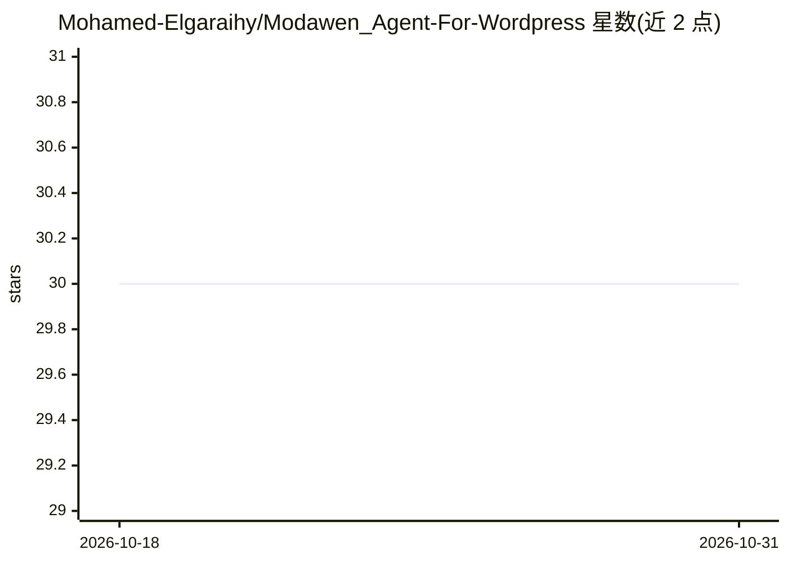

# Mohamed-Elgaraihy/Modawen_Agent-For-Wordpress

⭐ 30 · Python · 推送 2026-09-07 · [GitHub](https://github.com/Mohamed-Elgaraihy/Modawen_Agent-For-Wordpress) · 个人维护

**面向 WordPress 站长的自主多 Agent 内容营销系统**

基于 Streamlit 的多 Agent 应用：由 6 个 Agent 组成流水线——选题生成、抓取 Google 实时搜索结果做研究、撰写 SEO 结构化文章、生成标题与 SEO 标签并选择分类、配图（OpenAI GPT-4 或 Pexels）、并将已发布文章转写为 Twitter(X) 推文串。通过 WordPress Application Password 发布管理站点，支持 Gemini/OpenAI/Anthropic/DeepSeek 四家 API Key 任选，支持动态模型选择、YouTube 视频转博客、站内自动内链与基于 SQLite 的生成历史统计面板。安装方式为 git clone 源码 + pip 依赖，运行 streamlit run app.py 或后台 scheduler.py 定时自动发布。需 Python 3.8+、WordPress 站点与至少一个 LLM API Key。

## 筛选速览

| 维度 | 判定 | 备注 |
|---|---|---|
| AI 角色 | `ai-native` | 本体是模型或模型工具 |
| 许可风险 | `none` | — |
| 部署形态 | `library` | 以包/库形式分发 |
| 模型依赖 | locked-api |  |
| 硬件要求 | — | 无带数字的原话,不猜 |
| 安装摩擦 | `low` | 无编译、无系统依赖或容器化 |
| 成熟度 | — | 结构信号不足 |

## 能力要点

- 6-Agent 流水线：选题→搜索研究→写作→SEO 元数据→配图→社媒推文串
- 支持 Gemini / OpenAI / Anthropic / DeepSeek API Key，动态模型选择
- YouTube 视频转录转 SEO 博客文章
- 扫描 WordPress 数据库自动插入指向旧文的内链；SQLite 本地统计面板

## 适用场景

- WordPress 站长定时自动生成并发布 SEO 文章
- 将 YouTube 视频转录转写为博客文章
- 发布后自动生成 Twitter(X) 推文串引流

## 场景标签

`多智能体` `AI 写作` · 领域:Agent 开发

## 证据(README 行号)

> L7: **Modawen Agent for WordPress** is a completely autonomous, AI-powered multi-agent SaaS that researches live trends,
> L12: The system uses a massive **6-Agent Architecture**:

## 星数曲线

2026-10-18 30 → 2026-10-31 30（+0）

---
*卡片 v1 · prompt 1.4 · 生成 2026-10-26 · 置信度 mid · 依据 README sha `70af974608db` · [字段定义](../../DATASET.md)*
