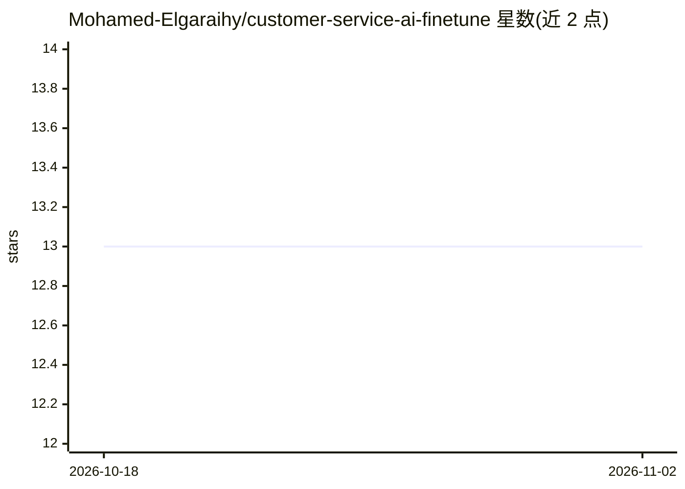

# Mohamed-Elgaraihy/customer-service-ai-finetune

⭐ 13 · Jupyter Notebook · 推送 2026-08-24 · [GitHub](https://github.com/Mohamed-Elgaraihy/customer-service-ai-finetune) · [官网](https://www.youtube.com/watch?v=cnkNQlqxg18) · 个人维护

**在 Colab 上用 Unsloth 微调 Qwen 2.5 客服助手的训练项目**

提供 Qwen 2.5 模型的客服助手微调代码与示例数据集：含可直接在 Google Colab 运行的 train.ipynb 笔记本、训练脚本 train.py 与问答格式的 dataset.json。使用 Unsloth 库与 Python 完成训练、测试与保存，训练完成后可将模型上传至 HuggingFace（需自备 token）。用户可编辑 dataset.json 替换为自己的问答数据。面向想快速上手 LLM 微调的开发者，配有 YouTube 视频教程。

## 筛选速览

| 维度 | 判定 | 备注 |
|---|---|---|
| AI 角色 | `ai-ecosystem` | LLM/agent 周边工具 |
| 许可风险 | `none` | — |
| 部署形态 | `None` |  |
| 模型依赖 | — | README 未给出锁定关系 |
| 硬件要求 | — | 无带数字的原话,不猜 |
| 安装摩擦 | `low` | 无编译、无系统依赖或容器化 |
| 成熟度 | — | 结构信号不足 |

## 能力要点

- Qwen 2.5 + Unsloth 的完整微调流程（训练/测试/保存）
- Colab 一键打开运行，自动拉取示例数据集
- 支持替换 dataset.json 为自定义问答数据
- 训练后可上传模型至 HuggingFace

## 适用场景

- 我想把 Qwen 2.5 微调成自己业务的客服问答助手
- 在 Google Colab 上零本地环境跑通一次 LLM 微调
- 跟着视频教程学习 Unsloth 微调流程

## 场景标签

`微调` `教程课程` · 领域:学习与行业

## 证据(README 行号)

> L5: هذا المستودع يحتوي على أكواد وبيانات لتدريب (Fine-Tuning) نموذج الذكاء الاصطناعي **Qwen 2.5** ليكون مساعداً ذكياً لخ
> L34: This repository contains the code and dataset to fine-tune the **Qwen 2.5** AI model to serve as a smart customer s

## 星数曲线

2026-10-18 13 → 2026-11-02 13（+0）

---
*卡片 v1 · prompt 1.4 · 生成 2026-10-31 · 置信度 high · 依据 README sha `badb7e25f0c9` · [字段定义](../../DATASET.md)*
