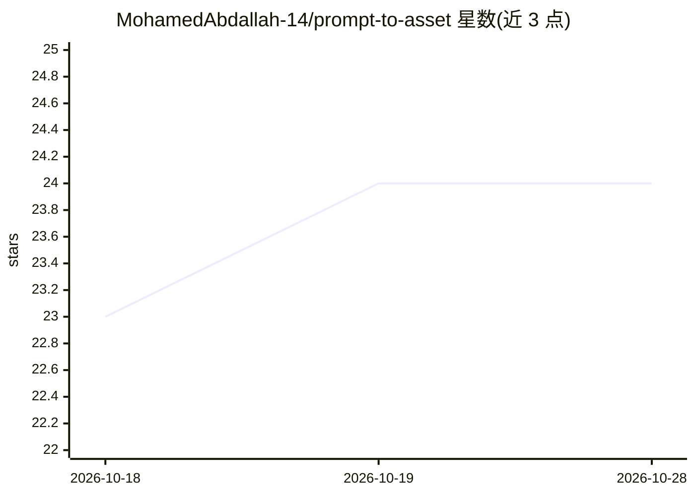

# MohamedAbdallah-14/prompt-to-asset

⭐ 24 · TypeScript · MIT · 推送 2026-10-18 · [GitHub](https://github.com/MohamedAbdallah-14/prompt-to-asset) · [官网](https://www.npmjs.com/package/prompt-to-asset) · 个人维护

**给开发者的免费图像资产生成 MCP server + CLI**

面向开发者的软件资产生成工具：将一句描述转化为 logo、应用图标、favicon、OG 图、启动图、SVG 与各平台打包产物。提供 MCP server 与 CLI 两种入口，路由至 30+ 图像模型，优先使用免费路径（Cloudflare Workers AI、NVIDIA NIM、HF Inference、Stable Horde、Pollinations）或离线 SVG 模式，可实现零 API key、零费用完成。生成后执行尺寸、透明度、调色板偏移、WCAG 对比度等校验，再离线扇出为 iOS/Android/PWA/Flutter 等格式。运行需 Node ≥ 20.11。

## 筛选速览

| 维度 | 判定 | 备注 |
|---|---|---|
| AI 角色 | `ai-native` | 本体是模型或模型工具 |
| 许可风险 | `permissive` | MIT |
| 部署形态 | `library` | 以包/库形式分发 |
| 模型依赖 | — | README 未给出锁定关系 |
| 硬件要求 | — | 无带数字的原话,不猜 |
| 安装摩擦 | `low` | 无编译、无系统依赖或容器化 |
| 成熟度 | — | 结构信号不足 |

## 能力要点

- 免费优先路由：Cloudflare Workers AI / NVIDIA NIM / HF Inference / Stable Horde / Pollinations，可零 key 完成
- 三种执行模式：inline_svg（宿主 LLM 直接写 SVG）、external_prompt_only（粘贴到任意 Web UI）、api（直调提供商）
- 路由表含 Never 列，按模型能力拒绝不当请求（如透明 PNG 不走 Imagen）
- tier-0 校验：尺寸、alpha、调色板 ΔE2000、WCAG 对比度、wordmark OCR Levenshtein

## 适用场景

- 通过 AI 助手或 CLI 一句话生成 favicon、logo 与应用图标
- 把一张母图离线扇出为 iOS/Android/PWA/Flutter 全平台图标包
- 无付费 API key 时用免费路径生成生产可用素材

## 场景标签

`图像生成` · 领域:内容生成

## 证据(README 行号)

> L5:  Free image generation for developers, from the CLI or your AI assistant.
> L6: Turn one brief into app icons, favicons, OG images, logos, splash screens, SVG, and platform bundles using the best 
> L99: - **Free CLI-first generation** — `p2a doctor`, `p2a pick`, and the MCP tools rank free API routes before paid mode

## 星数曲线

2026-10-18 23 → 2026-10-28 24（+1）

---
*卡片 v1 · prompt 1.4 · 生成 2026-10-27 · 置信度 high · 依据 README sha `e01618d081d2` · [字段定义](../../DATASET.md)*
