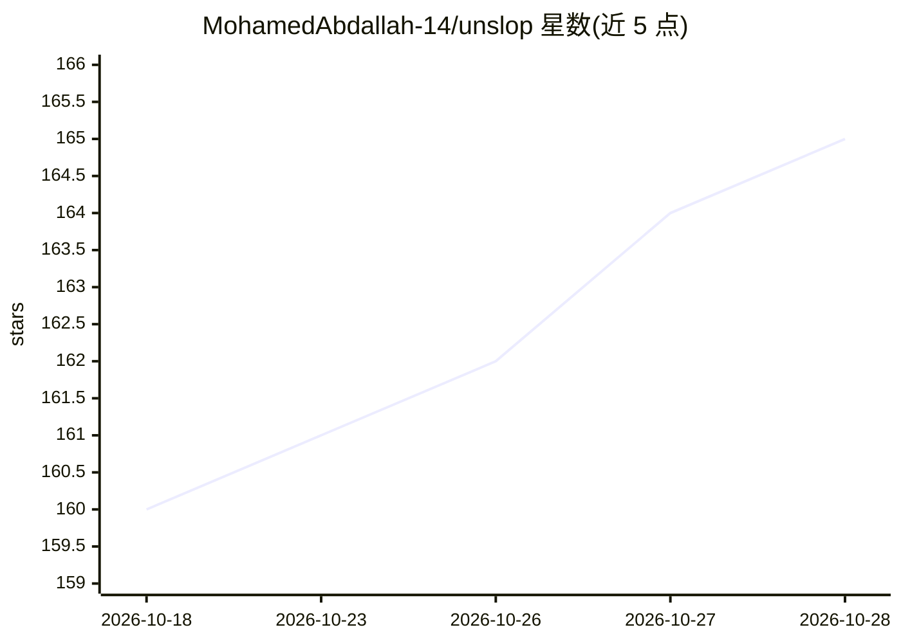

# MohamedAbdallah-14/unslop

⭐ 165 · Python · MIT · 推送 2026-10-26 · [GitHub](https://github.com/MohamedAbdallah-14/unslop) · [官网](https://mohamedabdallah-14.github.io/unslop/) · 个人维护

**给写作者与工程师：去除 AI 文本痕迹、保留代码与结构的改写插件**

面向 Claude Code、Cursor、 Windsurf、Cline、Gemini CLI、Codex 六个 AI 助手平台及独立 CLI 的文本改写工具：以规则与正则剥离 AI 写作特征（套话、堆叠对冲、破折号、AI 用语），输出时代码块、URL、标题、表格等逐字节保留；确定性模式下内容漂移即失败。提供五种改写档位、语音档案匹配、推理痕迹剥离、可选 LLM 模式与检测器评分。安装方式覆盖插件市场命令、git clone、pipx 及非开发者指南。

## 筛选速览

| 维度 | 判定 | 备注 |
|---|---|---|
| AI 角色 | `ai-enhanced` | 去掉 AI 部分产品仍成立 |
| 许可风险 | `permissive` | MIT |
| 部署形态 | `library` | 以包/库形式分发 |
| 模型依赖 | locked-api |  |
| 硬件要求 | — | 无带数字的原话,不猜 |
| 安装摩擦 | `low` | 无编译、无系统依赖或容器化 |
| 成熟度 | — | 结构信号不足 |

## 能力要点

- 五种模式：subtle/balanced/full/voice-match/anti-detector
- 代码、URL、标题等结构逐字节保留，确定性模式漂移即失败
- 同一 skill 通过各平台加载机制接入六个 AI 助手
- 可剥离 agent 输出中的 <thinking>/<analysis> 等推理痕迹

## 适用场景

- 工程师在 agent 输出发布前清理 AI 写作痕迹
- 求职信、文章、LinkedIn 帖子等真人阅读文本的语气改写
- 保存个人写作风格档案供跨会话复用

## 场景标签

`AI 写作` · 领域:内容生成

## 证据(README 行号)

> L46: Mostly engineers cleaning up agent output before it ships, and people writing things real humans will read — cover 
> L169: Code blocks, inline code, URLs, headings, YAML frontmatter, tables, blockquotes — byte-identical on the way out. D

## 星数曲线

2026-10-18 160 → 2026-10-28 165（+5）

---
*卡片 v1 · prompt 1.4 · 生成 2026-10-23 · 置信度 mid · 依据 README sha `316c2a11a546` · [字段定义](../../DATASET.md)*
