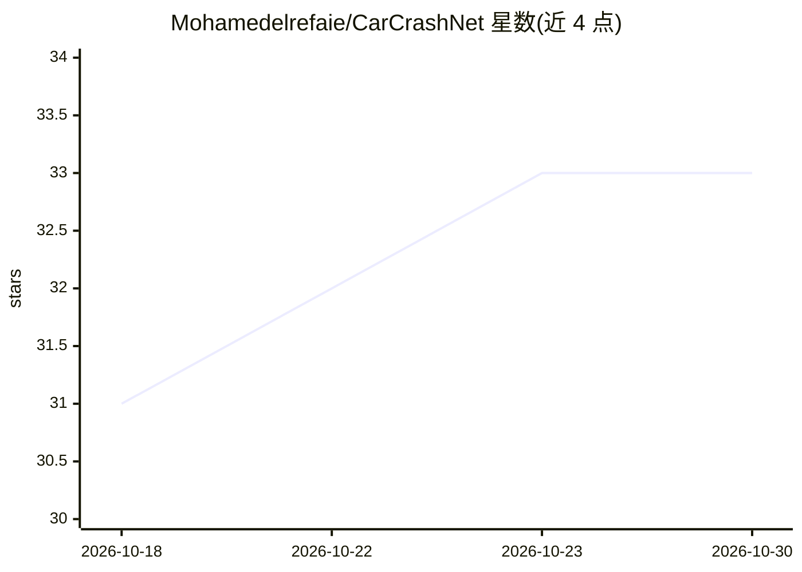

# Mohamedelrefaie/CarCrashNet

⭐ 33 · 推送 2026-08-03 · [GitHub](https://github.com/Mohamedelrefaie/CarCrashNet) · [官网](https://arxiv.org/abs/2605.07098) · 组织维护

**结构碰撞仿真的大规模数据集与层级神经求解器基准**

MIT 与丰田研究院发布的汽车碰撞仿真基准项目：包含 15,567 个经验证的有限元碰撞仿真（6.65 TB），覆盖 14,742 个保险杠梁柱撞组件级案例与 825 个整车案例（Yaris/Neon/Silverado），以 VTKHDF 场数据与时程曲线等多模态格式发布。附带 CrashSolver——利用有限元部件层级作为归纳偏置的整车碰撞场预测神经网络，在三个整车基准上报告了与 Transolver/GeoTransolver/FIGConvUNet 的对比结果。OpenRadioss 工作流经 Ansys LS-DYNA 与物理碰撞试验对标验证。数据集在同行评审通过后公开，当前仓库仅提供高层描述。

## 筛选速览

| 维度 | 判定 | 备注 |
|---|---|---|
| AI 角色 | `ai-knowledge` | 知识聚合/清单类 |
| 许可风险 | `none` | — |
| 部署形态 | `None` |  |
| 模型依赖 | — | README 未给出锁定关系 |
| 硬件要求 | — | 无带数字的原话,不猜 |
| 安装摩擦 | `low` | 无编译、无系统依赖或容器化 |
| 成熟度 | — | 结构信号不足 |

## 能力要点

- 15,567 个验证的有限元碰撞仿真，6.65 TB 多模态数据
- 组件级（14,742）与整车级（825，三款车型）两级数据集
- CrashSolver 层级部件感知神经求解器，利用 FE 部件层级作归纳偏置
- OpenRadioss 对标 LS-DYNA：峰值墙力误差 7.2%、内能 0.5%

## 适用场景

- 训练与评测整车碰撞场预测的神经求解器
- 在公开基准上比较数据驱动碰撞仿真方法
- 开展耐撞性代理建模与设计变量研究

## 场景标签

`模型评测` · 领域:评测与运维

## 证据(README 行号)

> L18: **CarCrashNet** is the first public, high-fidelity, open-source benchmark for data-driven structural crash simulati
> L60: CarCrashNet releases **15,567** validated finite-element crash simulations — **6.65 TB** of mesh-resolved fields, t
> L170: > **The CarCrashNet datasets will be publicly released upon acceptance / completion of peer review.**

## 星数曲线

2026-10-18 31 → 2026-10-30 33（+2）

---
*卡片 v1 · prompt 1.4 · 生成 2026-10-25 · 置信度 high · 依据 README sha `d14ff6af6a4c` · [字段定义](../../DATASET.md)*
