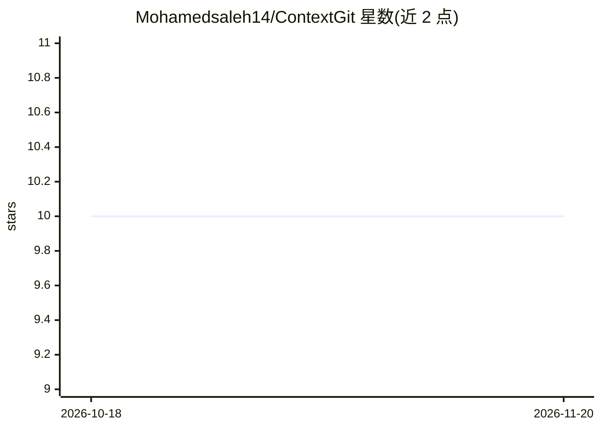

# Mohamedsaleh14/ContextGit

⭐ 10 · Python · MIT · 推送 2025-12-05 · [GitHub](https://github.com/Mohamedsaleh14/ContextGit) · [官网](https://contextgit.com) · 个人维护

**为 Claude Code 等 LLM 编码助手提供需求追溯的 CLI 工具**

contextgit 是本地优先、git 友好的 CLI 工具，在业务需求、系统规格、架构决策、源代码与测试之间维护双向追溯关系。核心机制包括追溯图谱、基于校验和的上游变更过期检测、按文件提取相关需求的精确上下文抽取。为 LLM 集成提供全命令 JSON 输出、MCP Server 以及生成 .cursorrules/CLAUDE.md 集成文件。支持 Markdown/Python/JS/TS 元数据格式，数据存储于本地 .contextgit/ 索引，无网络调用。需 Python 3.11+。

## 筛选速览

| 维度 | 判定 | 备注 |
|---|---|---|
| AI 角色 | `ai-enhanced` | 去掉 AI 部分产品仍成立 |
| 许可风险 | `permissive` | MIT |
| 部署形态 | `desktop` | 安装包/桌面程序 |
| 模型依赖 | — | README 未给出锁定关系 |
| 硬件要求 | — | 无带数字的原话,不猜 |
| 安装摩擦 | `low` | 无编译、无系统依赖或容器化 |
| 成熟度 | — | 结构信号不足 |

## 能力要点

- 需求→规格→架构→代码→测试的双向追溯图谱与过期检测
- 全命令 JSON 输出与 extract 命令，为 LLM 提供精确上下文
- MCP Server 集成 Claude Desktop，init 自动生成 .cursorrules/CLAUDE.md
- 本地优先：索引存于 .contextgit/，元数据用 YAML frontmatter/HTML 注释

## 适用场景

- 在 LLM 辅助开发流程中保持需求与代码同步
- 实现需求变更的下游影响分析
- 为 LLM prompt 精确提取相关需求上下文
- 用 git hooks 在提交时自动扫描需求元数据

## 场景标签

 · 领域:开发者工具/需求管理

## 证据(README 行号)

> L14: contextgit is a local-first, git-friendly CLI tool that maintains bidirectional traceability between business requi
> L38: 🎯 **LLM-Optimized**
> L43: - **MCP Server**: Native Model Context Protocol integration for Claude Desktop (v1.2+)

## 星数曲线

2026-10-18 10 → 2026-11-20 10（+0）

---
*卡片 v1 · prompt 1.4 · 生成 2026-11-20 · 置信度 high · 依据 README sha `d93bfbfb5eb5` · [字段定义](../../DATASET.md)*
