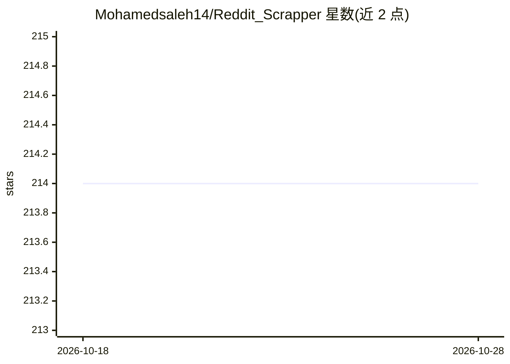

# Mohamedsaleh14/Reddit_Scrapper

⭐ 215 · Python · NOASSERTION · 推送 2026-02-16 · [GitHub](https://github.com/Mohamedsaleh14/Reddit_Scrapper) · [官网](https://www.cronlytic.com) · 个人维护

**抓取 Reddit 帖子并用 GPT 分析营销痛点与商机的工具**

Python 应用，通过 Reddit API 抓取配置的与探索性 subreddit 的帖子与评论，用 OpenAI 或 Anthropic 模型（可配置切换，经 Batch API）识别表达痛点、具产品建设潜力的帖子，按相关性、痛点清晰度、情绪强度、可实现性、技术深度等多维打分，结果存入本地 SQLite，并通过 Streamlit 交互仪表盘筛选浏览。内置月度预算上限、令牌限额、批次重试等成本控制。需自备 Reddit API 凭据与 LLM API key，从源码安装运行；许可限个人非商业使用。

## 筛选速览

| 维度 | 判定 | 备注 |
|---|---|---|
| AI 角色 | `ai-native` | 本体是模型或模型工具 |
| 许可风险 | `none` | NOASSERTION |
| 部署形态 | `library` | 以包/库形式分发 |
| 模型依赖 | — | README 未给出锁定关系 |
| 硬件要求 | — | 无带数字的原话,不猜 |
| 安装摩擦 | `low` | 无编译、无系统依赖或容器化 |
| 成熟度 | — | 结构信号不足 |

## 能力要点

- Reddit 抓取 + GPT 打分识别营销痛点与产品机会
- OpenAI / Anthropic 可配置切换，Batch API 批处理
- 多维打分（相关性/痛点/情绪/可实现性/技术深度）与 ROI 评估
- 月度预算上限、令牌限额、批次重试等成本控制机制

## 适用场景

- 从 Reddit 讨论中挖掘可做成产品的用户痛点
- 以打分和仪表盘筛选高价值营销线索
- 定时运行管道持续积累商机数据

## 场景标签

`网页抓取` `数据分析` · 领域:效率与自动化

## 证据(README 行号)

> L10: A Python application that scrapes Reddit for potential marketing leads, analyzes them with GPT models, and identifi
> L17: This tool uses a combination of Reddit's API and AI models (OpenAI or Anthropic) to:

## 星数曲线

2026-10-18 214 → 2026-10-28 214（+0）

---
*卡片 v1 · prompt 1.4 · 生成 2026-10-22 · 置信度 mid · 依据 README sha `f96b5658efe0` · [字段定义](../../DATASET.md)*
