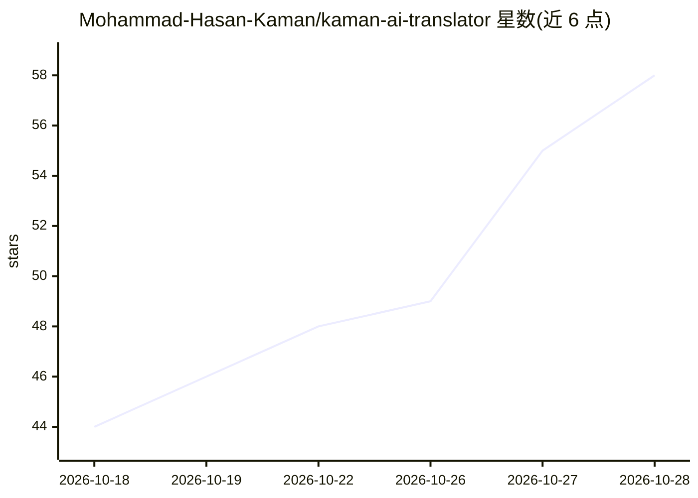

# Mohammad-Hasan-Kaman/kaman-ai-translator

⭐ 58 · Python · MIT · 推送 2026-10-22 · [GitHub](https://github.com/Mohammad-Hasan-Kaman/kaman-ai-translator) · 个人维护

**把 PDF/EPUB 整本书自动译为学术波斯语的桌面应用**

基于 PyQt6 的 Windows 桌面翻译工具，面向长篇书籍的英↔波斯翻译：按段落智能分块并携带滚动上下文尾，逐书检测标题与重复标签生成结构模板注入提示词，支持暂停/续译/取消与逐页即时保存，扫描页经图像 OCR 处理，可选 QC 复查环自动比对修正。引擎接 Google Gemini 或任意 OpenAI 兼容端点（Ollama/LM Studio/llama.cpp 本地或云端），API key 以 Windows DPAPI 加密存储。提供可执行文件与源码运行两种方式，303 项离线测试。

## 筛选速览

| 维度 | 判定 | 备注 |
|---|---|---|
| AI 角色 | `ai-native` | 本体是模型或模型工具 |
| 许可风险 | `permissive` | MIT |
| 部署形态 | `desktop` | 安装包/桌面程序 |
| 模型依赖 | local-ok | 支持本地模型 |
| 硬件要求 | — | 无带数字的原话,不猜 |
| 安装摩擦 | `low` | 无编译、无系统依赖或容器化 |
| 成熟度 | — | 结构信号不足 |

## 能力要点

- 整本书批量翻译，逐页保存、跨重启续译
- 逐书结构模板与滚动上下文保持术语一致
- 扫描页图像 OCR 翻译，不跳过
- QC 复查环自动标记并修正漏译与语义漂移
- 导出 Markdown 与含页面图片的 RTL HTML 书

## 适用场景

- 把英文 PDF/EPUB 书整本译成波斯语并导出成品 PDF
- 对长文档翻译做逐页人工复核与质检
- 用本地 Ollama/LM Studio 端点离线翻译书籍

## 场景标签

 · 领域:文档翻译/桌面工具

## 证据(README 行号)

> L3: **A Persian-first desktop studio that turns PDF & EPUB books into fluent, academic Persian — and back into English —
> L61: - **Google Gemini** (official SDK), or **any OpenAI-compatible endpoint** — Ollama / LM Studio / llama.cpp locally,

## 星数曲线

2026-10-18 44 → 2026-10-28 58（+14）

---
*卡片 v1 · prompt 1.4 · 生成 2026-10-25 · 置信度 mid · 依据 README sha `d8657ce88665` · [字段定义](../../DATASET.md)*
