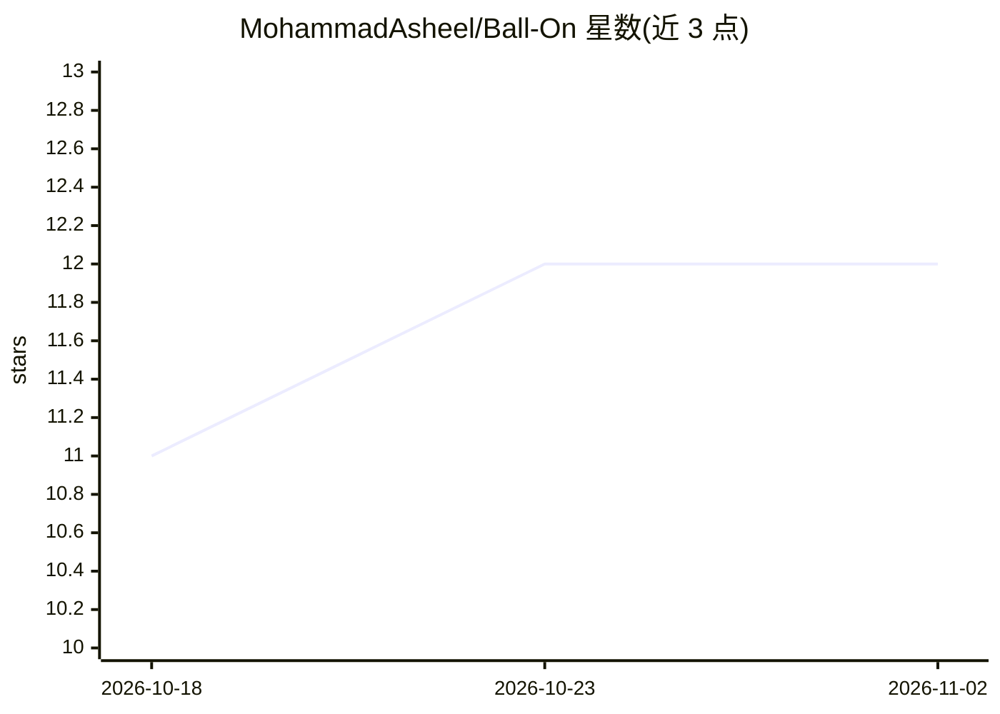

# MohammadAsheel/Ball-On

⭐ 12 · TypeScript · 推送 2026-09-08 · [GitHub](https://github.com/MohammadAsheel/Ball-On) · [官网](https://ballon-eight.vercel.app) · 组织维护

**用机器学习估算足球运动员转会费的端到端预测系统**

基于 transfermarkt-datasets 历史数据构建的回归系统：从转会前球员表现与市场估值特征出发，训练线性回归、Ridge、随机森林、XGBoost 等模型估算转会费，并与实际转会值对比评估。采用严格的时间安全特征与防数据泄漏设计（仅用转会前数据，2022-07 后为保留测试窗口）。提供 FastAPI 预测端点与 Streamlit 仪表盘。项目处于早期阶段（12 个阶段中完成 2 个），明确声明输出为估算值且数据偏向欧洲足球。

## 筛选速览

| 维度 | 判定 | 备注 |
|---|---|---|
| AI 角色 | `ai-native` | 本体是模型或模型工具 |
| 许可风险 | `none` | — |
| 部署形态 | `None` |  |
| 模型依赖 | — | README 未给出锁定关系 |
| 硬件要求 | — | 无带数字的原话,不猜 |
| 安装摩擦 | `low` | 无编译、无系统依赖或容器化 |
| 成熟度 | `idea` | |

## 能力要点

- 特征严格使用转会日期前的数据，含泄漏回归测试
- 提供 Mean/Median/Previous Value/线性/Ridge/RF/XGBoost 共 7 类模型
- FastAPI 估算端点支持假想场景、球员估值与历史转会复现
- 时序化训练划分：2021-07 前训练、2021/22 选择、2022-07 后保留测试

## 适用场景

- 估算足球运动员的假想或历史转会费
- 评估统计模型对真实转会定价的逼近程度
- 分析各特征对转会费估算的贡献（SHAP/Ridge 解释）

## 场景标签

`数据分析` · 领域:效率与自动化

## 证据(README 行号)

> L3: An end-to-end machine learning system that predicts football player transfer fees using historical performance data,
> L32: - **ML:** scikit-learn, XGBoost

## 星数曲线

2026-10-18 11 → 2026-11-02 12（+1）

---
*卡片 v1 · prompt 1.4 · 生成 2026-11-01 · 置信度 high · 依据 README sha `d315bd6c5eea` · [字段定义](../../DATASET.md)*
