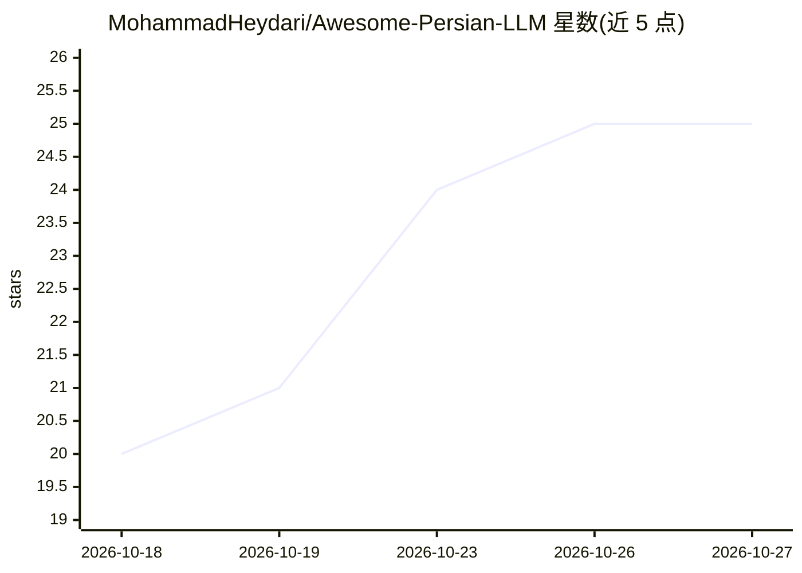

# MohammadHeydari/Awesome-Persian-LLM

⭐ 25 · Python · 推送 2026-06-24 · [GitHub](https://github.com/MohammadHeydari/Awesome-Persian-LLM) · 个人维护

**波斯语 LLM 资源清单：论文、模型、数据集与评测一站收录**

面向研究者、开发者与爱好者的波斯语大模型资源策展清单，收录内容覆盖波斯语 LLM 相关论文（训练、评测、指令微调、RAG、语言学等方向）、开源模型、数据集、嵌入模型与基准、代码仓库、API 平台、排行榜及博客文章，按类别目录组织，MIT 许可。README 说明其动机为波斯语在 LLM 生态中代表性不足，旨在便于构建、训练与部署波斯语 AI 系统。

## 筛选速览

| 维度 | 判定 | 备注 |
|---|---|---|
| AI 角色 | `ai-knowledge` | 知识聚合/清单类 |
| 许可风险 | `none` | — |
| 部署形态 | `None` |  |
| 模型依赖 | — | README 未给出锁定关系 |
| 硬件要求 | — | 无带数字的原话,不猜 |
| 安装摩擦 | `low` | 无编译、无系统依赖或容器化 |
| 成熟度 | — | 结构信号不足 |

## 能力要点

- 按 15+ 个类别组织：论文、数据集、模型、仓库、基准、API、博客等
- 覆盖训练/评测/对齐/RAG/跨语言等研究方向的论文条目
- 收录多个波斯语 LLM 模型与排行榜（Dorna、PersianMind、MIZAN 等）

## 适用场景

- 查找波斯语 LLM 的训练与评测论文
- 寻找波斯语数据集、嵌入模型和基准
- 了解波斯语 LLM 生态的模型与平台现状

## 场景标签

`精选清单` · 领域:学习与行业

## 证据(README 行号)

> L3: A curated list of **resources for Persian (Farsi) Large Language Models (LLMs)** including papers, datasets, models,
> L5: This repository aims to collect everything related to **Persian NLP + LLMs** in one place for researchers, developer
> L162: Persian is still an underrepresented language in the LLM ecosystem.

## 星数曲线

2026-10-18 20 → 2026-10-27 25（+5）

---
*卡片 v1 · prompt 1.4 · 生成 2026-10-27 · 置信度 high · 依据 README sha `7bde2e1cfb81` · [字段定义](../../DATASET.md)*
