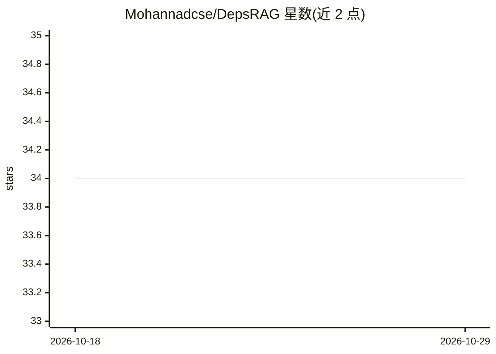

# Mohannadcse/DepsRAG

⭐ 34 · Python · MIT · 推送 2026-06-08 · [GitHub](https://github.com/Mohannadcse/DepsRAG) · 个人维护

**回答软件依赖问题的多智能体 RAG 聊天机器人**

以聊天方式分析软件依赖的 LLM 应用：通过 deps.dev API 递归采集 PyPI、NPM、Cargo、Go 四生态的直接与传递依赖，构建 Neo4j 知识图谱，并对每个包下载制品、扫描原生模块（.c/.dll/.so 等）写入图中。基于 Agno 的多智能体分工：协调者、依赖图智能体（自然语言转 Cypher）、搜索智能体（DuckDuckGo 搜索与 OSV 漏洞库）、以及校验答案的 Critic 智能体。需 Python 3.11+、Neo4j 实例与 OpenAI/Azure/Gemini 之一的 API key。

## 筛选速览

| 维度 | 判定 | 备注 |
|---|---|---|
| AI 角色 | `ai-native` | 本体是模型或模型工具 |
| 许可风险 | `permissive` | MIT |
| 部署形态 | `self-host` | docker 或自建部署 |
| 模型依赖 | locked-api |  |
| 硬件要求 | — | 无带数字的原话,不猜 |
| 安装摩擦 | `low` | 无编译、无系统依赖或容器化 |
| 成熟度 | — | 结构信号不足 |

## 能力要点

- 四生态依赖树构建为 Neo4j 知识图谱（单次原子写入）
- 制品级原生模块识别（按生态扫描 .c/.cpp/.dll/.so 等扩展名）
- Agno 多智能体：协调、依赖图、搜索、Critic 校验四个专职智能体
- OSV 漏洞库查询与自然语言转 Cypher 查询

## 适用场景

- 查询某个包的完整依赖树、深度与关键路径
- 检查依赖链中是否存在已知安全漏洞
- 识别依赖包里包含的原生模块与体积信息

## 场景标签

`多智能体` `聊天机器人` `知识图谱` `RAG` · 领域:Agent 开发

## 证据(README 行号)

> L7: `DepsRAG` is an AI-powered chatbot that answers questions about software dependencies by representing them as a Know
> L18: - ✅ **Answer Validation**: Critic agent for quality assurance

## 星数曲线

2026-10-18 34 → 2026-10-29 34（+0）

---
*卡片 v1 · prompt 1.4 · 生成 2026-10-25 · 置信度 mid · 依据 README sha `525ab12e022a` · [字段定义](../../DATASET.md)*
