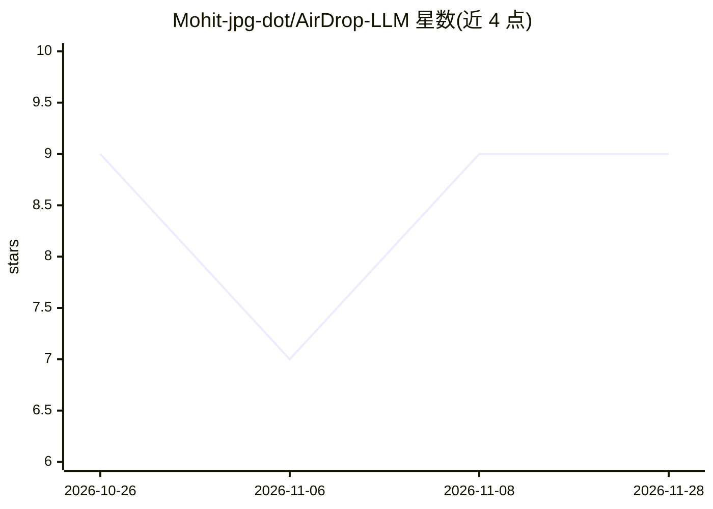

# Mohit-jpg-dot/AirDrop-LLM

⭐ 9 · Rust · MIT · 推送 2026-10-22 · [GitHub](https://github.com/Mohit-jpg-dot/AirDrop-LLM) · 个人维护

**将本地多台笔记本池化为分布式 LLM 推理集群的网关**

以 Rust 实现的离线、零依赖多节点 pipeline 并行 LLM 推理 broker：通过 UDP 广播发现同一 Wi-Fi 下的对等节点，将异构硬件（Apple Metal 与 NVIDIA CUDA）的 RAM 与 GPU 算力经 TCP 套接字池化，跨节点执行 32B/70B 模型的流水线并行推理。内置 OpenAI 兼容 API 网关（:9995，支持流式 SSE），可接入 Cursor、Aider、Continue.dev、OpenHands、LangChain 等客户端；附带硬件热保护（88°C 阈值）、推测解码、网络降级回退本地锚模型等机制。通过 npm 提供安装。

## 筛选速览

| 维度 | 判定 | 备注 |
|---|---|---|
| AI 角色 | `ai-ecosystem` | LLM/agent 周边工具 |
| 许可风险 | `permissive` | MIT |
| 部署形态 | `library` | 以包/库形式分发 |
| 模型依赖 | — | README 未给出锁定关系 |
| 硬件要求 | — | 无带数字的原话,不猜 |
| 安装摩擦 | `medium` | 含编译或系统依赖之一 |
| 成熟度 | — | 结构信号不足 |

## 能力要点

- UDP 零配置 P2P 节点发现，池化异构 Metal + CUDA 硬件
- 内置 OpenAI 兼容网关（:9995），支持流式与阻塞模式
- Delta 张量序列化与静态层缓存降低带宽（LZ4 压缩）
- 热保护与电池守护、网络降级时回退本地 1.5B 锚模型

## 适用场景

- 在无云依赖的离线环境中运行 32B/70B 级别本地模型
- 让 Cursor/Aider 等 IDE 编码代理连接本地分布式推理集群
- 将多台消费级笔记本组成统一推理池
-  air-gapped 环境下提供 OpenAI 兼容的本地推理端点

## 场景标签

`推理引擎` · 领域:训练与推理

## 证据(README 行号)

> L12: ### **Zero-Dependency · 100% Offline · Multi-Node Pipeline-Parallel LLM Inference Broker**
> L46: * 🔌 **OpenAI-Compatible Off-Heap Gateway (`:9995`)**: Built-in high-performance reverse proxy exposing standard `/v
> L51: * 🌐 **Zero-Config P2P Discovery (UDP Broadcast `:9998`)**: Zero manual IP configuration required. Run `airdrop join

## 星数曲线

2026-10-26 9 → 2026-11-28 9（+0）

---
*卡片 v1 · prompt 1.4 · 生成 2026-11-20 · 置信度 high · 依据 README sha `f717692eff81` · [字段定义](../../DATASET.md)*
