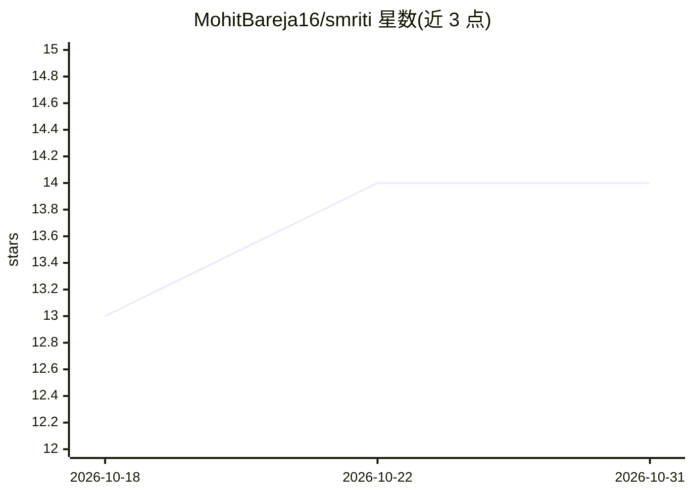

# MohitBareja16/smriti

⭐ 14 · Python · Apache-2.0 · 推送 2026-10-08 · [GitHub](https://github.com/MohitBareja16/smriti) · 个人维护

**本地私有文档问答助手：快慢双路径回答自己笔记与证件**

面向学生与个人用户的本地优先 AI 助手：读取 PDF/Word/Markdown/文本笔记与个人文档，回答问题时给出页码引用。采用 System 1/System 2 双路径：简单问题由无模型的快速匹配即时作答，复杂问题升级到本地 Ollama 驱动的搜索 Agent。内置注入防护、grounding 校验、AES-256 证件加密与审计日志，全部数据留在本机。以 pip 安装的 Python CLI + Chainlit 网页应用提供，同时附带可复现实验框架供研究使用。限制：无法读取无文本层的扫描 PDF，无 GPU 笔记本上本地模型回答较慢。

## 筛选速览

| 维度 | 判定 | 备注 |
|---|---|---|
| AI 角色 | `ai-native` | 本体是模型或模型工具 |
| 许可风险 | `permissive` | Apache-2.0 |
| 部署形态 | `library` | 以包/库形式分发 |
| 模型依赖 | local-ok | 支持本地模型 |
| 硬件要求 | — | 无带数字的原话,不猜 |
| 安装摩擦 | `low` | 无编译、无系统依赖或容器化 |
| 成熟度 | `idea` | |

## 能力要点

- System 1 快速路径无需 AI 模型即可作答，复杂问题才调用本地 Agent
- 提示注入检测与阻断、grounding 校验、私密信息（证件号/邮箱/电话）隐藏
- 个人证件类文档 AES-256 加密存储，数据全部留在本机
- 完整追踪审计（audit/trace 命令）与对比 RAG/Agent/Guardrails 的评测框架

## 适用场景

- 向自己的课程笔记提问并得到带页码引用的解答
- 管理并加密成绩单、证件等个人文档，隐私数据不出本机
- 研究者复现快慢双路径与 guardrails 的对比实验

## 场景标签

`文档问答` `模型评测` · 领域:评测与运维

## 证据(README 行号)

> L8: **Smriti** (स्मृति, Sanskrit for *"memory"*) is a free, private AI assistant for your **notes, books, past papers an
> L10: It thinks in two ways:
> L11: - ⚡ **Fast:** simple questions like *"When is my DBMS exam?"* are answered instantly, without any AI model.

## 星数曲线

2026-10-18 13 → 2026-10-31 14（+1）

---
*卡片 v1 · prompt 1.4 · 生成 2026-10-31 · 置信度 high · 依据 README sha `4c90d035d528` · [字段定义](../../DATASET.md)*
