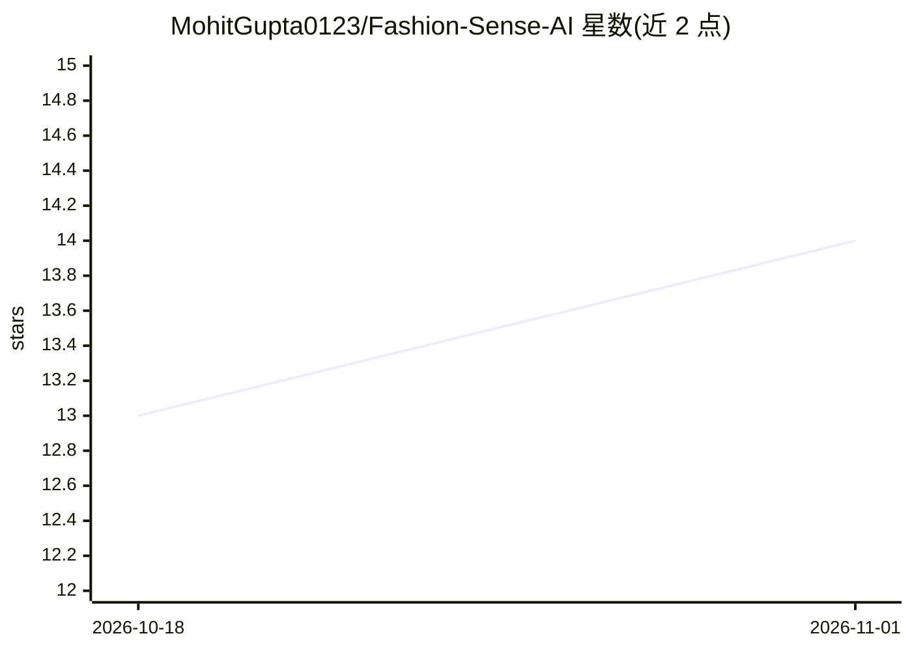

# MohitGupta0123/Fashion-Sense-AI

⭐ 14 · Jupyter Notebook · 推送 2026-04-27 · [GitHub](https://github.com/MohitGupta0123/Fashion-Sense-AI) · [官网](https://fashion-sense-ai.streamlit.app/) · 个人维护

**AI 时尚视觉搜索与穿搭推荐助手（CLIP+FAISS+Gemma）**

基于 Streamlit 的 Web 应用：用户上传服装图片或输入文字描述，经 CLIP/SentenceTransformers 嵌入与 FAISS 索引检索相似商品；支持模拟用户浏览历史并生成基于历史的推荐；穿搭补全建议由 Gemma-3B 通过 Hugging Face Inference API 生成，需用户在侧边栏输入 HF token。安装方式为 git clone 源码、pip 安装依赖、streamlit run 运行，Python>=3.11。可作为电商 AI 集成的基础。

## 筛选速览

| 维度 | 判定 | 备注 |
|---|---|---|
| AI 角色 | `ai-native` | 本体是模型或模型工具 |
| 许可风险 | `none` | — |
| 部署形态 | `library` | 以包/库形式分发 |
| 模型依赖 | — | README 未给出锁定关系 |
| 硬件要求 | — | 无带数字的原话,不猜 |
| 安装摩擦 | `low` | 无编译、无系统依赖或容器化 |
| 成熟度 | — | 结构信号不足 |

## 能力要点

- 图片/文字双通道时尚商品相似检索（CLIP + FAISS）
- Gemma-3B（HF Inference API）生成穿搭补全建议
- 模拟用户浏览历史并基于历史推荐
- 从库存与在线数据提取流行趋势关键词

## 适用场景

- 上传一张服装图片找相似款商品
- 输入文字描述检索匹配的时尚单品
- 让 LLM 根据已选单品补全鞋包等搭配建议

## 场景标签

`推荐系统` `多模态` `语义搜索` · 领域:知识与检索

## 证据(README 行号)

> L22: * **Image-based Search**: Upload any fashion item image to retrieve visually similar products.
> L34: |🧠 LLM-based Outfit Generator|Uses **Gemma 3B** via Hugging Face API to suggest outfit completions.|

## 星数曲线

2026-10-18 13 → 2026-11-01 14（+1）

---
*卡片 v1 · prompt 1.4 · 生成 2026-10-31 · 置信度 mid · 依据 README sha `932c9ea82587` · [字段定义](../../DATASET.md)*
