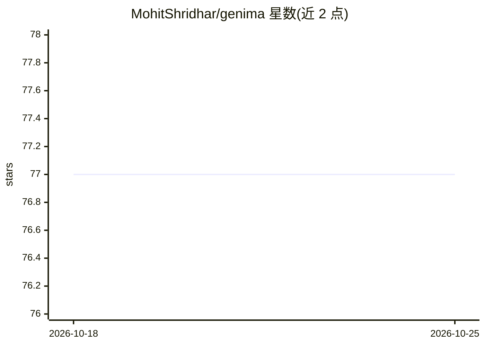

# MohitShridhar/genima

⭐ — · [GitHub]() · 个人维护

**微调 Stable Diffusion 生成机器人操作动作的研究代码库**

CoRL 2024 论文 Generative Image as Action Models 的官方复现代码：在 RGB 观测上以 ControlNet 微调 Stable Diffusion，绘制关节球作为视觉动作目标，再训练 ACT 控制器将其映射为关节动作序列，用于 RLBench 仿真机械臂操作任务。提供 25 任务的预训练 checkpoint 与训练、评测、Colosseum 扰动测试全流程脚本；用 poetry 与 conda 管理 Python 3.10.12 环境。扩散模型训练需 A100 80GB，评测与控制器训练可在 24GB 消费级 GPU 上进行。RLBench 数据集需自行生成，真机数据与 checkpoint 不发布。

## 筛选速览

| 维度 | 判定 | 备注 |
|---|---|---|
| AI 角色 | `ai-native` | 本体是模型或模型工具 |
| 许可风险 | `permissive` | — |
| 部署形态 | `library` | 以包/库形式分发 |
| 模型依赖 | — | README 未给出锁定关系 |
| 硬件要求 | `gpu-24g` | |
| 安装摩擦 | `low` | 无编译、无系统依赖或容器化 |
| 成熟度 | — | 结构信号不足 |

## 能力要点

- Stable Diffusion + ControlNet 在 RGB 观测上绘制关节动作目标
- ACT 控制器将目标图像映射为关节动作序列
- 提供 25 个 RLBench 任务的预训练 checkpoint
- 支持 Colosseum 6 类扰动评测与多 GPU 扩散模型训练

## 适用场景

- 复现论文中 RLBench 机械臂操作实验结果
- 在扰动场景（颜色/光照/背景纹理变化）下评测操作泛化
- 以 Genima 方法为基础训练自己的机器人操作智能体

## 场景标签

 · 领域:机器人学习

## 证据(README 行号)

> L7: Genima fine-tunes Stable Diffusion to draw joint-actions on RGB observations.

## 星数曲线

2026-10-18 77 → 2026-10-25 77（+0）

---
*卡片 v1 · prompt 1.4 · 生成 2026-10-24 · 置信度 mid · 依据 README sha `46d86e56a504` · [字段定义](../../DATASET.md)*
