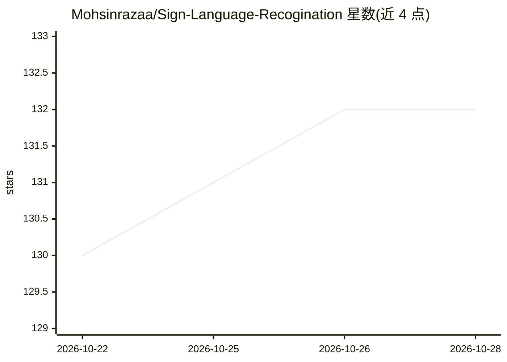

# Mohsinrazaa/Sign-Language-Recogination

⭐ 132 · Jupyter Notebook · 推送 2026-10-20 · [GitHub](https://github.com/Mohsinrazaa/Sign-Language-Recogination) · 个人维护

**手语识别应用：摄像头识别手势并组句，面向学习/毕设**

本科毕业设计项目，基于 CNN 的美国手语识别桌面应用。功能模块包括：Capture.py 采集自定义数据集、cnn_model.py 用卷积神经网络训练并以 h5 格式保存模型、Recognise.py 识别手势、recogniseAppend.py 将识别结果组成句子，含 pyttsx3 语音输出与 PyQt5/tkinter 界面。仓库附带训练数据集与非商用许可的已训练模型。要求 Python 3.7.x，依赖 TensorFlow/Keras/OpenCV 等，运行 Dashboard.py 启动，仅限 Windows（依赖 win32api/winGuiAuto）。

## 筛选速览

| 维度 | 判定 | 备注 |
|---|---|---|
| AI 角色 | `ai-native` | 本体是模型或模型工具 |
| 许可风险 | `none` | — |
| 部署形态 | `library` | 以包/库形式分发 |
| 模型依赖 | — | README 未给出锁定关系 |
| 硬件要求 | — | 无带数字的原话,不猜 |
| 安装摩擦 | `low` | 无编译、无系统依赖或容器化 |
| 成熟度 | — | 结构信号不足 |

## 能力要点

- CNN 训练手语识别模型并以 h5 格式保存
- Capture.py 支持采集自定义数据集
- 手势识别后组句并可用 pyttsx3 朗读
- 仓库附带数据集与限非商用的已训练模型

## 适用场景

- 我想做一个手语识别的学习或毕业设计项目
- 我想用自己的数据集训练手语识别模型并实测识别效果
- 我想把手势识别结果组成句子并通过语音输出

## 场景标签

`目标检测` · 领域:感知与多模态

## 证据(README 行号)

> L7: * The Recognise.py will recognise the gesture as per the trained dataset, recogniseAppend.py file will make a format
> L9: * Capture.py file will help in creating your own dataset and cnn_model.py file will use cnn deep neural nets to trai

## 星数曲线

2026-10-22 130 → 2026-10-28 132（+2）

---
*卡片 v1 · prompt 1.4 · 生成 2026-10-22 · 置信度 mid · 依据 README sha `593ff9bc411c` · [字段定义](../../DATASET.md)*
