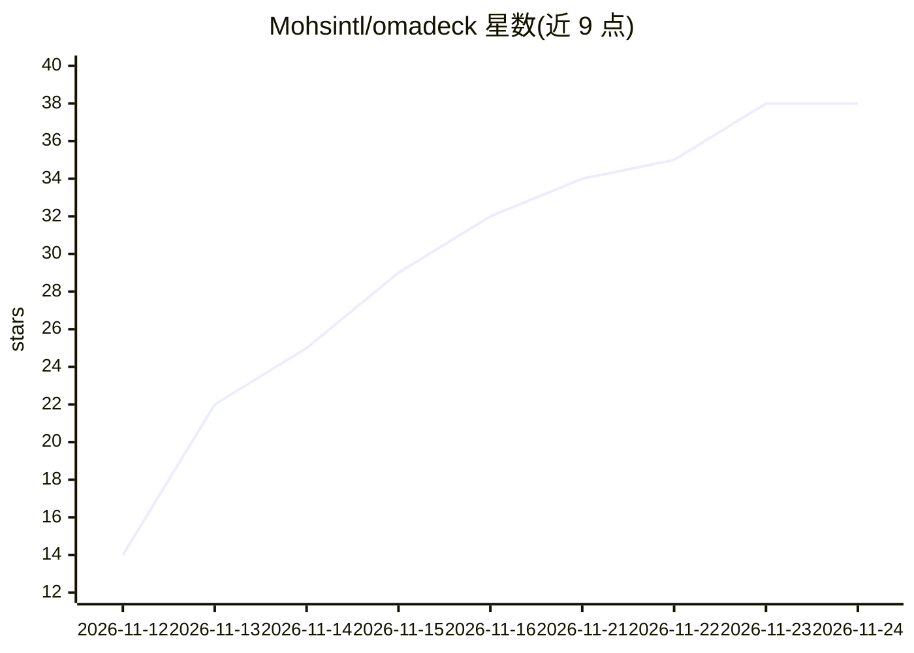

# Mohsintl/omadeck

⭐ 39 · Python · Apache-2.0 · 推送 2026-11-20 · [GitHub](https://github.com/Mohsintl/omadeck) · [官网](https://mohsintl.is-a.dev/omadeck/) · 个人维护

**手机遥控 Linux 桌面的 PWA 遥控盘，带可选 AI 语音命令**

面向 Omarchy / Hyprland Arch 用户的手机遥控器：通过同一 Wi-Fi 或 Tailscale 访问 HTTPS PWA，提供工作区、窗口、媒体、浏览器、终端等按键控制，支持语音输入与自定义按键序列。AI 部分为可选的自然语言命令执行，支持 Groq、Ollama、OpenAI 等多家 provider 及 vLLM 等兼容端点；常用命令直接本地执行不耗 token。语音转文字可用 faster-whisper 本地运行。安装经 git clone 与 install.sh 脚本完成，需 hyprctl、wtype 与 Python 3.11+。

## 筛选速览

| 维度 | 判定 | 备注 |
|---|---|---|
| AI 角色 | `ai-enhanced` | 去掉 AI 部分产品仍成立 |
| 许可风险 | `permissive` | Apache-2.0 |
| 部署形态 | `None` |  |
| 模型依赖 | local-ok | 支持本地模型 |
| 硬件要求 | — | 无带数字的原话,不猜 |
| 安装摩擦 | `low` | 无编译、无系统依赖或容器化 |
| 成熟度 | — | 结构信号不足 |

## 能力要点

- 手机 PWA 遥控 Omarchy/Hyprland 的工作区、窗口、媒体与终端操作
- 常用命令本地直接执行，不消耗 AI token；其余走 LLM 解析
- 支持 8 种 AI provider 及 OpenAI 兼容端点（vLLM、LM Studio）
- 语音转文字可用本地 faster-whisper，全离线可用

## 适用场景

- 把旧手机当作 Stream Deck 式的桌面遥控器
- 躺在沙发上用语音切换窗口、调音量、控制媒体
- 远程运行常用的终端命令组合（如 kill :3000）

## 场景标签

`语音识别` `GUI 自动化` · 领域:效率与自动化

## 证据(README 行号)

> L5:  A phone remote and voice control for Omarchy and Hyprland: workspaces, windows, media, typing, and an AI that runs 
> L74: **Obvious commands skip the AI.** "Volume to max", "volume 40 percent", "turn it up a bit", "focus the address bar"
> L86: - Pick a provider: **Groq**, **Ollama**, **OpenAI**, **OpenRouter**, **DeepSeek**, **Mistral**, **NVIDIA**, or a cu

## 星数曲线

2026-11-12 14 → 2026-11-24 38（+24）

---
*卡片 v1 · prompt 1.4 · 生成 2026-11-18 · 置信度 high · 依据 README sha `9011d7383bbf` · [字段定义](../../DATASET.md)*
