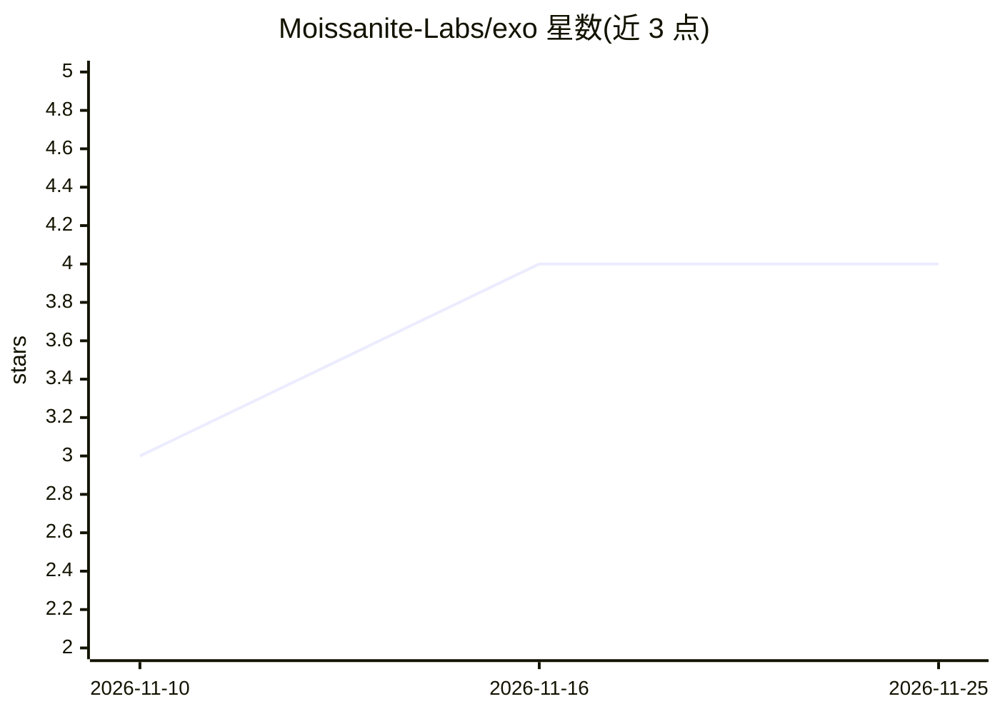

# Moissanite-Labs/exo

⭐ 4 · Python · MIT · 推送 2026-11-23 · [GitHub](https://github.com/Moissanite-Labs/exo) · [官网](https://exo.askaconsult.com/) · 组织维护

**面向个人的终端与浏览器编码 agent，跨会话保持单一连续记忆**

Exo 是一个以 Python 编写的独立 agent 系统，在终端（exo tui）与浏览器（exo web）两个客户端运行于同一核心。它以一个 agent 为单位维护 append-only、hash-chained 的日志与摘要树，使新线程不丢失上下文；每次模型调用记录路由、耗时与成本并由异常规则生成 findings。对外动作（发帖、发送、支付）经精确文本哈希的审批门，文本改动任一字符即重新审批。模型接入可用 API key 或 Claude Code 登录，安装通过 git clone 加安装脚本完成，要求 Python 3.11+ 与 macOS/Linux。

## 筛选速览

| 维度 | 判定 | 备注 |
|---|---|---|
| AI 角色 | `ai-native` | 本体是模型或模型工具 |
| 许可风险 | `permissive` | MIT |
| 部署形态 | `None` |  |
| 模型依赖 | locked-api |  |
| 硬件要求 | — | 无带数字的原话,不猜 |
| 安装摩擦 | `low` | 无编译、无系统依赖或容器化 |
| 成熟度 | `idea` | |

## 能力要点

- 单一 agent 携带跨会话连续记忆（append-only hash-chained 日志 + 摘要树）
- 对外动作用精确文本哈希审批门，座位签名答案、常设授权可过期
- 自观测 harness：记录每次模型调用的路由/耗时/成本并生成可验证 findings
- provider 无关的模型路由器带 fallback，按 turn 显示成本

## 适用场景

- 在终端以单一记忆持续的 agent 进行编码工作
- 需要每个对外动作精确审批的人机协作流程
- 追踪每次模型调用的耗时与成本

## 场景标签

`编码 Agent` `Agent 记忆` · 领域:Agent 开发

## 证据(README 行号)

> L5: **Exo is a coding agent for the terminal and the browser that keeps one memory across sessions, ties each
> L12: Exo is a standalone agent system for working well with language models. You talk to one agent. It keeps one
> L33: |**Two clients**|A terminal client (`exo`, the same as `exo tui`) and a web client (`exo web`), both drawn from one

## 星数曲线

2026-11-10 3 → 2026-11-25 4（+1）

---
*卡片 v1 · prompt 1.4 · 生成 2026-11-21 · 置信度 high · 依据 README sha `908fcd0c98ef` · [字段定义](../../DATASET.md)*
