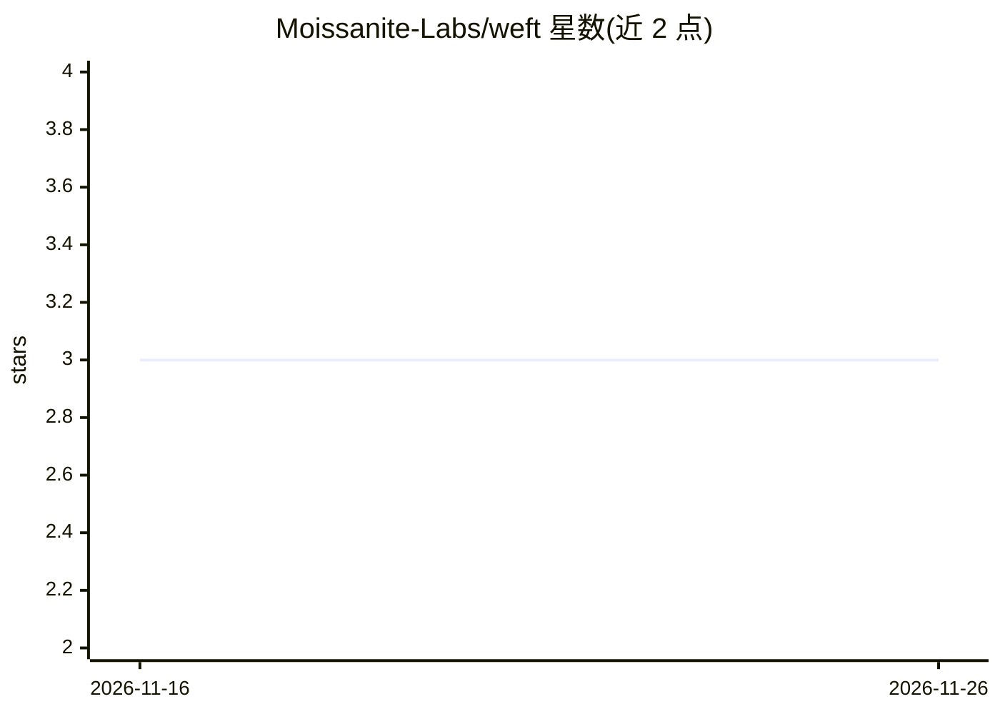

# Moissanite-Labs/weft

⭐ 3 · Python · Apache-2.0 · 推送 2026-11-25 · [GitHub](https://github.com/Moissanite-Labs/weft) · [官网](https://w3ft.org) · 组织维护

**在可检查约束内研究模型能力添加与迁移的开源研究项目**

Moissanite Labs 的研究仓库，研究向已训练网络添加能力或在独立训练的同源网络间迁移能力，同时保持已有能力不退化。软件部分包含七个组件：共享内存 arena（C1）、以 Python/C11/JS 三语言实现并对照 27 个共享测试向量的一致性安全门（C2）、组合归约器（C3）、Solidity 研究草稿（C4，仅离线模拟）、离线合约模拟器（C5）、遥测（C6）与含 WebGPU loom 的站点（C7），另有 Apple Silicon 包装入口。状态为早期研究，核心假设尚未被证明。

## 筛选速览

| 维度 | 判定 | 备注 |
|---|---|---|
| AI 角色 | `ai-knowledge` | 知识聚合/清单类 |
| 许可风险 | `permissive` | Apache-2.0 |
| 部署形态 | `library` | 以包/库形式分发 |
| 模型依赖 | — | README 未给出锁定关系 |
| 硬件要求 | — | 无带数字的原话,不猜 |
| 安装摩擦 | `low` | 无编译、无系统依赖或容器化 |
| 成熟度 | `idea` | |

## 能力要点

- C2 安全门以 Python、C11、JavaScript 三种语言实现，对照共享向量文件（27 例）测试
- 权重更新仅在固定 Frobenius 距离与资源预算谓词内提交
- 模型作为 cell 在共享内存 arena 中提出 A/B 候选更新并保留冻结核心
- 附带论文系列（HTML/PDF）、实验记录仓库 weft-loom 与预注册重跑

## 适用场景

- 研究在约束条件下向训练网络添加或迁移能力的方法
- 查看多语言一致实现的安全门与一致性测试向量设计
- 复现或审查其预注册的迁移实验流程

## 场景标签

`模型训练` · 领域:训练与推理

## 证据(README 行号)

> L6:  Open research on adding and transferring capabilities in trained networks under bounds we can check.
> L12:  Status: early research
> L43: holds the software, the site and the papers.

## 星数曲线

2026-11-16 3 → 2026-11-26 3（+0）

---
*卡片 v1 · prompt 1.4 · 生成 2026-11-22 · 置信度 mid · 依据 README sha `0a546ecd041a` · [字段定义](../../DATASET.md)*
