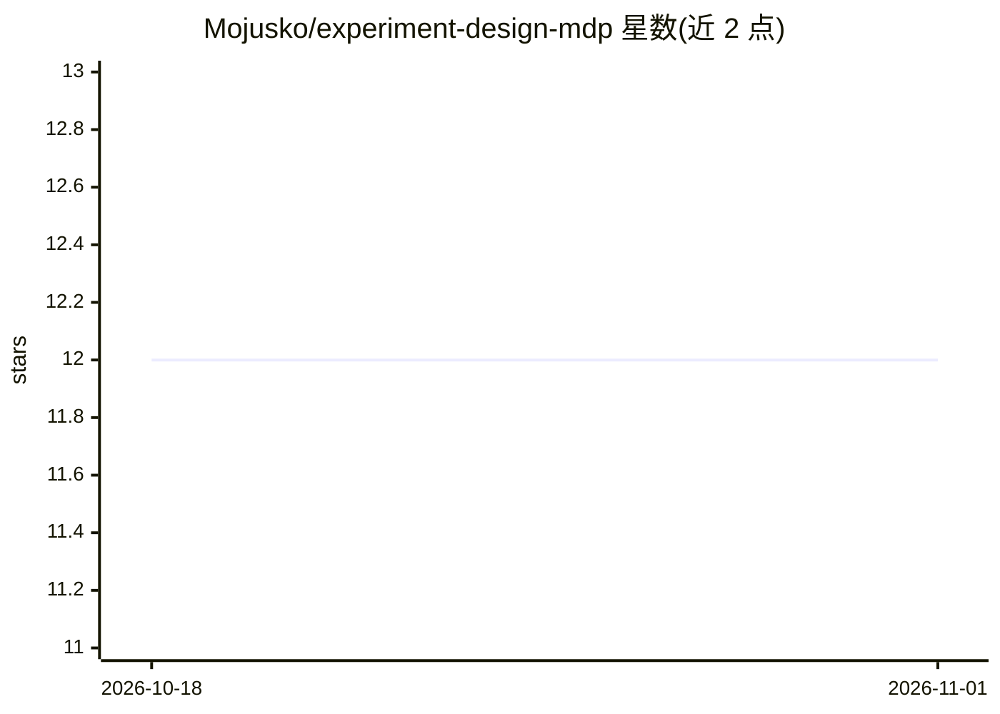

# Mojusko/experiment-design-mdp

⭐ 12 · Python · MIT · 推送 2026-01-27 · [GitHub](https://github.com/Mojusko/experiment-design-mdp) · 组织维护

**自适应实验设计的 Python 机器学习库，支持贝叶斯优化与主动学习**

DOExPy 是面向自适应实验设计的 Python 库，基于 numpy、cvxpy 与 stpy 构建。提供贝叶斯优化、主动学习与探索算法，以及带探索导向损失函数的实验设计与强化学习；支持无状态系统、表格 MDP、线性系统与线性 MDP 四类决策环境。用户需自行实现环境、反馈模型与效用函数（如 A/D/C/V 实验设计、最大识别等），库内含经典效用列表；求解可用内点法或 Frank-Wolfe，配合 DP/LP/策略迭代等方法。代码由 git clone 源码安装，配套 conda 环境文件。

## 筛选速览

| 维度 | 判定 | 备注 |
|---|---|---|
| AI 角色 | `ai-native` | 本体是模型或模型工具 |
| 许可风险 | `permissive` | MIT |
| 部署形态 | `library` | 以包/库形式分发 |
| 模型依赖 | — | README 未给出锁定关系 |
| 硬件要求 | — | 无带数字的原话,不猜 |
| 安装摩擦 | `low` | 无编译、无系统依赖或容器化 |
| 成熟度 | — | 结构信号不足 |

## 能力要点

- 贝叶斯优化、主动学习与实验设计算法实现
- 支持无状态系统、表格 MDP、线性系统、线性 MDP
- 内置 A/D/C/V 实验设计与最大识别等经典效用函数
- 配套 AISTATS 2023、NeurIPS 2024 论文成果

## 适用场景

- 科研与实验室场景中做自适应实验设计
- 构建带探索策略的强化学习与主动学习实验
- 自动驾驶实验室（self-driving lab）的实验预算分配

## 场景标签

`科研工具` · 领域:学习与行业

## 证据(README 行号)

> L1: Icon DOExPy - An ML experiment design library
> L5: 1. Bayesian Optimization, Maximum Identification
> L7: 3. Experiment Design, Reinforcement learning with advanced exploration directed loss-functions

## 星数曲线

2026-10-18 12 → 2026-11-01 12（+0）

---
*卡片 v1 · prompt 1.4 · 生成 2026-11-01 · 置信度 mid · 依据 README sha `72049650f4e5` · [字段定义](../../DATASET.md)*
