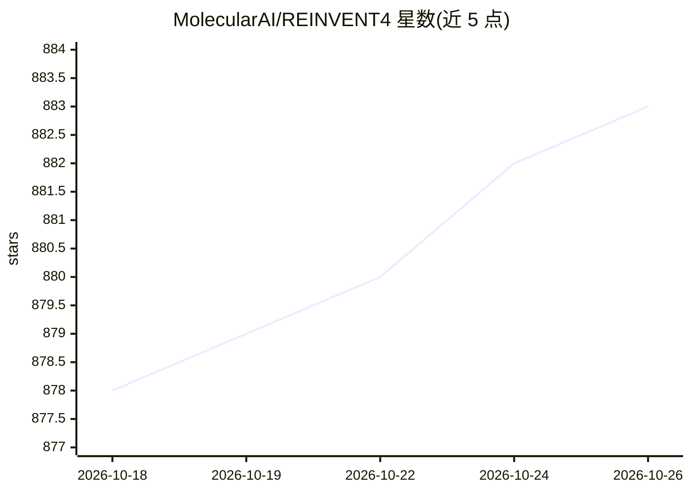

# MolecularAI/REINVENT4

⭐ 883 · Python · Apache-2.0 · 推送 2026-10-13 · [GitHub](https://github.com/MolecularAI/REINVENT4) · 组织维护

**AI 分子设计工具：从头设计、骨架跃迁与分子优化**

面向药物化学与小分子设计研究者的生成式分子设计工具：通过强化学习算法生成符合用户自定义多组分评分（属性谱）的分子，支持从头设计、骨架跃迁、R 基团替换、连接子设计与分子优化；可用迁移学习创建或预训练偏向输入分子集合的模型。以 Python 3.11+ 编写，经 git clone 加 install.py 或 uv 安装，支持 NVIDIA/AMD/Intel/Apple GPU 与 CPU，GPU 非必需但训练场景推荐；Linux 完全验证，Windows 支持有限。提供 scoring 插件机制与单元/集成测试。

## 筛选速览

| 维度 | 判定 | 备注 |
|---|---|---|
| AI 角色 | `ai-native` | 本体是模型或模型工具 |
| 许可风险 | `permissive` | Apache-2.0 |
| 部署形态 | `library` | 以包/库形式分发 |
| 模型依赖 | — | README 未给出锁定关系 |
| 硬件要求 | — | 无带数字的原话,不猜 |
| 安装摩擦 | `medium` | 含编译或系统依赖之一 |
| 成熟度 | `idea` | |

## 能力要点

- 强化学习生成符合多组分评分的优化分子
- 支持从头设计/骨架跃迁/R 基团替换/连接子设计/分子优化
- 迁移学习可创建偏向输入分子集合的生成模型
- 支持 NVIDIA/AMD/Intel ARC/Apple GPU 与 CPU，无 GPU 时自动回退 CPU

## 适用场景

- 药物发现中进行小分子从头设计与优化
- 基于已有分子集合用迁移学习生成结构相近的新分子
- 按属性谱定制评分函数做骨架跃迁或 R 基团替换

## 场景标签

`强化学习` · 领域:训练与推理

## 证据(README 行号)

> L5: REINVENT is a molecular design tool for de novo design, scaffold hopping,
> L7: molecule design tasks. REINVENT uses a Reinforcement Learning
> L8: (RL) algorithm to generate optimized molecules compliant with a user defined
> L9: property profile defined as a multi-component score. Transfer Learning (TL)

## 星数曲线

2026-10-18 878 → 2026-10-26 883（+5）

---
*卡片 v1 · prompt 1.4 · 生成 2026-10-21 · 置信度 mid · 依据 README sha `5968b061d364` · [字段定义](../../DATASET.md)*
