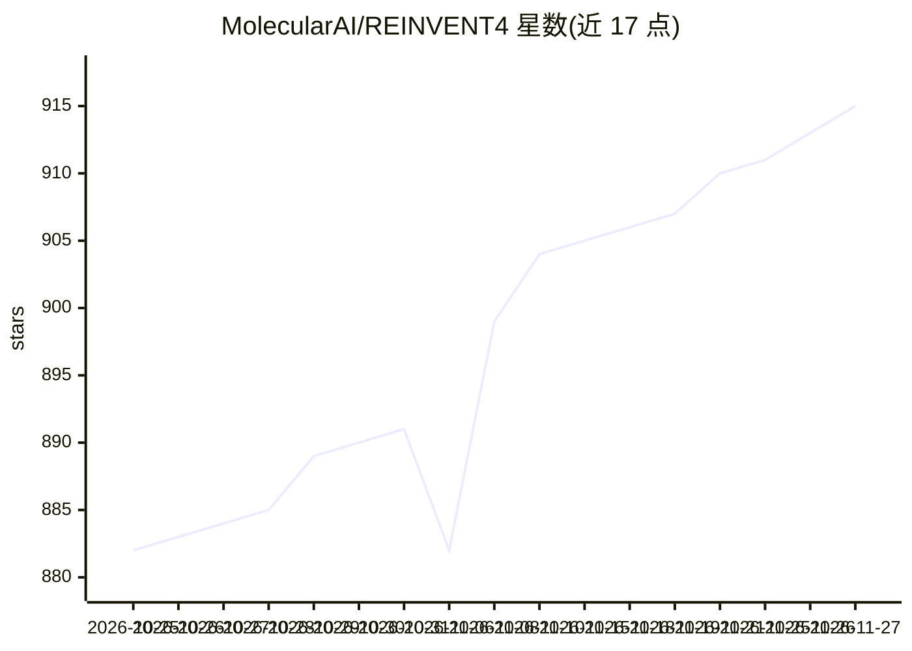

# MolecularAI/REINVENT4

⭐ 915 · Python · Apache-2.0 · 推送 2026-11-06 · [GitHub](https://github.com/MolecularAI/REINVENT4) · 组织维护

**面向药物设计的分子生成与优化工具**

REINVENT 4 是 AstraZeneca 维护的小分子设计工具，使用强化学习（RL）算法按用户定义的多组分评分生成优化分子，支持迁移学习（TL）预训练使生成分子更接近输入分子集合。功能覆盖从头设计、骨架跃迁、R 基团替换、连接子设计与分子优化。代码为 Python 3（>=3.11），开发与验证以 Linux 为主，Windows 支持有限；通过 conda 或 uv 安装，安装脚本可选 CUDA/ROCm/XPU/CPU 等处理器类型及 OpenEye、Chemprop 等可选依赖。论文已发表于 Journal of Cheminformatics。

## 筛选速览

| 维度 | 判定 | 备注 |
|---|---|---|
| AI 角色 | `ai-native` | 本体是模型或模型工具 |
| 许可风险 | `permissive` | Apache-2.0 |
| 部署形态 | `library` | 以包/库形式分发 |
| 模型依赖 | — | README 未给出锁定关系 |
| 硬件要求 | — | 无带数字的原话,不猜 |
| 安装摩擦 | `medium` | 含编译或系统依赖之一 |
| 成熟度 | — | 结构信号不足 |

## 能力要点

- 强化学习驱动、按多组分评分生成优化分子
- 支持迁移学习预训练与多种设计任务（骨架跃迁/R 基团替换/连接子设计）
- 安装脚本适配 CUDA/ROCm/Intel XPU/MPS 与 CPU 后端
- 提供评分插件机制与单元/集成测试

## 适用场景

- 针对目标性质剖面从头生成候选小分子
- 对已有分子做骨架跃迁或 R 基团替换
- 用迁移学习使生成分布偏向指定分子集合
- 链接子设计与先导分子优化

## 场景标签

`强化学习` · 领域:训练与推理

## 证据(README 行号)

> L5: REINVENT is a molecular design tool for de novo design, scaffold hopping,
> L7: molecule design tasks. REINVENT uses a Reinforcement Learning
> L20: REINVENT is being developed on Linux and supports both GPU and CPU. The Linux

## 星数曲线

2026-10-25 882 → 2026-11-27 915（+33）

---
*卡片 v1 · prompt 1.4 · 生成 2026-11-24 · 置信度 mid · 依据 README sha `0f8eb7a3d1eb` · [字段定义](../../DATASET.md)*
