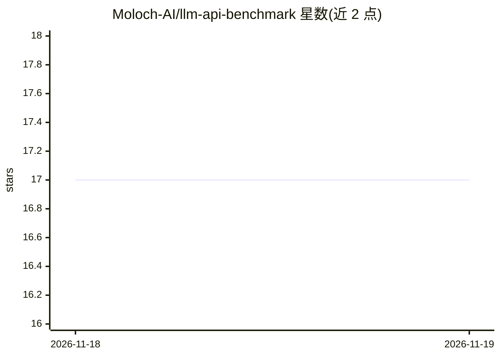

# Moloch-AI/llm-api-benchmark

⭐ 17 · Python · MIT · 推送 2026-11-18 · [GitHub](https://github.com/Moloch-AI/llm-api-benchmark) · [官网](https://molochai.dev/?utm_source=github&utm_medium=oss&utm_campaign=llm-api-benchmark) · 组织维护

**测量 OpenAI 兼容 LLM API 延迟与成本的开发者基准工具**

从客户端视角测量 OpenAI 兼容端点的 TTFT、TTFC、端到端延迟、输出 tok/s、分类错误率与成本；带版本化数据集 core-v1、请求/预算上限、dry-run 与确认机制，失败按 http_429/timeout 等类型记录，比较给出中位数差与 95% bootstrap 区间。密钥仅从环境变量读取并脱敏。以 pipx/pip 从 GitHub 安装，尚未发布到 PyPI。

## 筛选速览

| 维度 | 判定 | 备注 |
|---|---|---|
| AI 角色 | `ai-ecosystem` | LLM/agent 周边工具 |
| 许可风险 | `permissive` | MIT |
| 部署形态 | `library` | 以包/库形式分发 |
| 模型依赖 | — | README 未给出锁定关系 |
| 硬件要求 | — | 无带数字的原话,不猜 |
| 安装摩擦 | `low` | 无编译、无系统依赖或容器化 |
| 成熟度 | — | 结构信号不足 |

## 能力要点

- 流式 TTFT/TTFC 分开测量，避免推理模型被误读
- 端点级分类型错误率（429/503/timeout/stream_error）
- 运行有界：请求上限、USD 预算、--dry-run、并发默认 1 最高 8
- 输出 JSON/CSV/Markdown/自包含 HTML 报告，支持 bootstrap 区间比较

## 适用场景

- 上线前比较多个 LLM 端点的延迟与吞吐
- 按自己填写的单价核算各端点成本
- 排查端点错误类型与限流行为
- 在无网络无 key 的合成 demo 里熟悉报告格式

## 场景标签

`模型评测` · 领域:评测与运维

## 证据(README 行号)

> L10: `llm-bench` measures what your application would experience when it calls an LLM API. It reports
> L16: It works with any endpoint that speaks the OpenAI Chat Completions format: hosted APIs, gateways,
> L17: and local servers. It is a measurement tool for comparing endpoints from the client's side. It is

## 星数曲线

2026-11-18 17 → 2026-11-19 17（+0）

---
*卡片 v1 · prompt 1.4 · 生成 2026-11-18 · 置信度 high · 依据 README sha `8c6fce4887aa` · [字段定义](../../DATASET.md)*
