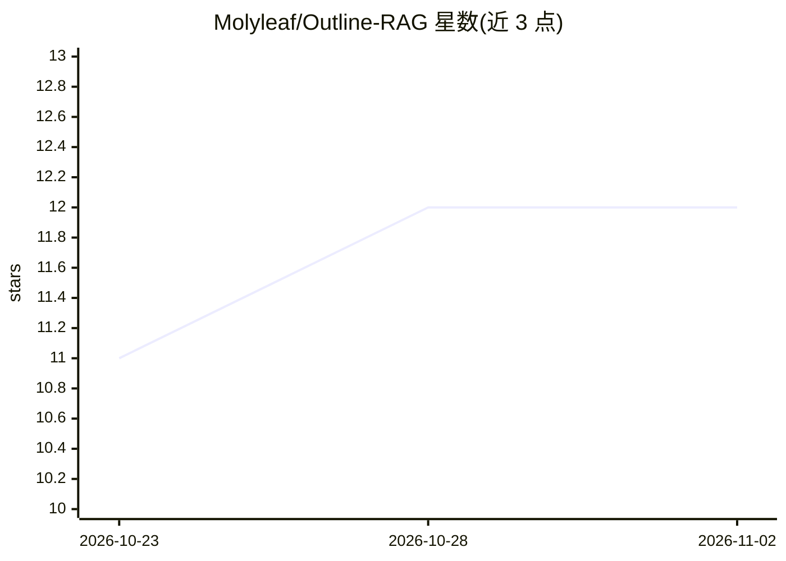

# Molyleaf/Outline-RAG

⭐ 12 · Python · NOASSERTION · 推送 2026-05-24 · [GitHub](https://github.com/Molyleaf/Outline-RAG) · 个人维护 · 中文 README

**为 Outline Wiki 附加 RAG 对话问答的系统**

面向开源 Outline Wiki 的检索增强生成（RAG）问答系统：通过 Outline API 读取文档，经 LangChain 管线做上下文感知分块、PGVector 向量检索与 SiliconFlow Reranker 重排，配合 Redis 任务队列与 Webhook 去抖实现增量同步；内置四路意图分类（百科问答/创作/角色扮演/闲聊）与引用标注规则，并集成 GitLab OIDC 单点登录。模型侧依赖 SiliconFlow API（默认 Qwen 系列），部署方式为 Docker Compose 加 Nginx 反代，或本地 Python 3.13 源码运行。注意其意图分类内置了特定游戏“余烬”的世界观分类器。

## 筛选速览

| 维度 | 判定 | 备注 |
|---|---|---|
| AI 角色 | `ai-native` | 本体是模型或模型工具 |
| 许可风险 | `none` | NOASSERTION |
| 部署形态 | `self-host` | docker 或自建部署 |
| 模型依赖 | — | README 未给出锁定关系 |
| 硬件要求 | — | 无带数字的原话,不猜 |
| 安装摩擦 | `low` | 无编译、无系统依赖或容器化 |
| 成熟度 | — | 结构信号不足 |

## 能力要点

- LangChain + FastAPI 全异步管线，PGVector 向量存储与重排
- Redis 任务队列与 Webhook 去抖实现文档增量同步
- 四路意图分类路由（百科/创作/角色扮演/闲聊），百科问答强制引用标注
- GitLab OIDC 单点登录与 Redis 全局 LLM 缓存

## 适用场景

- 给自己团队的 Outline 知识库加一个带引用来源的问答入口
- 基于 Wiki 文档做沉浸式角色扮演或内容创作
- 本地开发调试 RAG 管线（Python 3.13 + PostgreSQL/pgvector + Redis）

## 场景标签

`RAG` `聊天机器人` `文档问答` · 领域:对话与助手

## 证据(README 行号)

> L13: **Bringing the power of Large Language Models (LLMs) to your Outline knowledge base for intelligent, contextual, an
> L15: Outline-RAG is a state-of-the-art Retrieval-Augmented Generation (RAG) system tailored specifically for the open-so
> L42:  * **Query (Encyclopedia/QA)**: Leverages documents from the knowledge base, enforcing rigorous citation rules (`[来

## 星数曲线

2026-10-23 11 → 2026-11-02 12（+1）

---
*卡片 v1 · prompt 1.4 · 生成 2026-11-01 · 置信度 mid · 依据 README sha `2f8889e3a163` · [字段定义](../../DATASET.md)*
