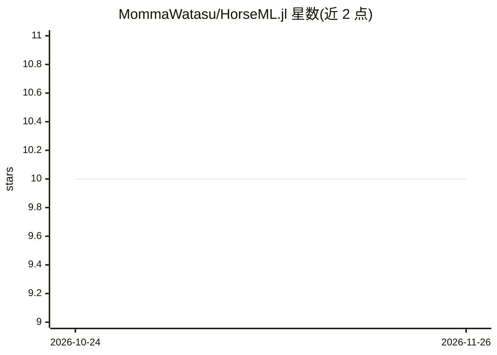

# MommaWatasu/HorseML.jl

⭐ 10 · Julia · MIT · 推送 2026-07-03 · [GitHub](https://github.com/MommaWatasu/HorseML.jl) · [官网](https://mommawatasu.github.io/HorseML.jl/stable) · 个人维护

**Julia 语言的机器学习库，覆盖回归到神经网络**

面向 JuliaLang 用户的机器学习库，提供从线性回归、多项式回归等基础算法到决策树、聚类、神经网络的多种模型构建能力，README 中展示了决策树可视化、多项式回归与聚类结果的示例，并注明适合初学者。通过 Julia 内置的 Pkg 包管理器安装（pkg> add HorseML），文档以 stable 与 dev 两个版本提供，CI 与代码覆盖率信息可见。

## 筛选速览

| 维度 | 判定 | 备注 |
|---|---|---|
| AI 角色 | `ai-native` | 本体是模型或模型工具 |
| 许可风险 | `permissive` | MIT |
| 部署形态 | `None` |  |
| 模型依赖 | — | README 未给出锁定关系 |
| 硬件要求 | — | 无带数字的原话,不猜 |
| 安装摩擦 | `low` | 无编译、无系统依赖或容器化 |
| 成熟度 | — | 结构信号不足 |

## 能力要点

- 提供从线性回归到神经网络的多种算法
- 决策树模型支持可视化
- 聚类与多项式回归等模型示例
- 通过 Julia Pkg 包管理器安装

## 适用场景

- 在 Julia 中训练回归或神经网络模型
- 学习机器学习基础算法的入门实践
- 构建并可视化决策树与聚类模型

## 场景标签

`模型训练` · 领域:训练与推理

## 证据(README 行号)

> L9: HorseML is machine learning library for JuliaLang. You can use various algorithms, from basic algorithms such as lin
> L18: This library is ML library for JuliaLang. HorseML can be installed using the Julia package manager.　You can build m

## 星数曲线

2026-10-24 10 → 2026-11-26 10（+0）

---
*卡片 v1 · prompt 1.4 · 生成 2026-11-20 · 置信度 high · 依据 README sha `992f6b161185` · [字段定义](../../DATASET.md)*
