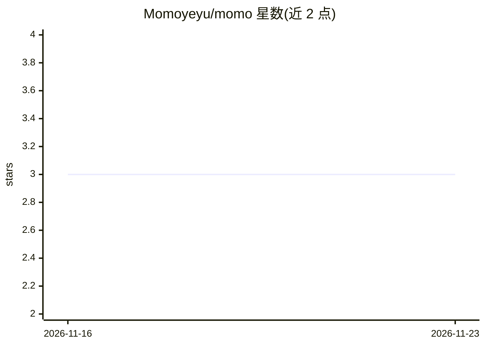

# Momoyeyu/momo

⭐ 3 · Python · MIT · 推送 2026-11-22 · [GitHub](https://github.com/Momoyeyu/momo) · [官网](https://momoyeyu.github.io/momo/) · 个人维护 · 中文 README

**以相处、记忆与共同成长为核心的开源 AI 陪伴游戏**

面向终端用户的桌面 AI 陪伴游戏：通过文字或麦克风对话，以 Live2D 形象（默认 Hiyori 模型）配合表情与动作回应；语音识别随应用提供，语音回复为可选接入的 GPT-SoVITS 等服务。核心机制围绕记忆——用户可查看、编辑或删除记忆，并支持对话回顾、存读档与数据导出/导入。对话发送到用户自行配置的兼容服务（地址、API key、模型）。macOS 上还支持以已有 Minecraft Java 角色陪玩。项目高速开发中，功能变化较大。

## 筛选速览

| 维度 | 判定 | 备注 |
|---|---|---|
| AI 角色 | `ai-native` | 本体是模型或模型工具 |
| 许可风险 | `permissive` | MIT |
| 部署形态 | `None` |  |
| 模型依赖 | — | README 未给出锁定关系 |
| 硬件要求 | — | 无带数字的原话,不猜 |
| 安装摩擦 | `medium` | 含编译或系统依赖之一 |
| 成熟度 | `idea` | |

## 能力要点

- 记忆可查看、编辑、删除，支持存读档与数据导出/导入
- Live2D 形象与表情动作回应，语音识别随应用提供
- 可选接入 GPT-SoVITS 语音合成，支持打断与继续
- macOS 上可用已有 Minecraft Java 1.21.1 Fabric 角色陪玩

## 适用场景

- 想要一个能记住相处细节的桌面 AI 伙伴
- 通过语音和表情动作进行日常闲聊陪伴
- 在 macOS 上让 AI 角色陪自己玩 Minecraft

## 场景标签

`聊天机器人` · 领域:对话与助手

## 证据(README 行号)

> L4:  在这里，慢慢熟悉彼此。 一款以相处、记忆与共同成长为方向的 AI 陪伴游戏。
> L35: |**有表情的回应**|Live2D 形象、表情与动作；可选接入 GPT-SoVITS，听见语音回复并打断、继续。|
> L39: |**一起玩 Minecraft**|macOS 上授权后，momo 可以用你已有的 Minecraft Java 1.21.1 Fabric 角色探索、采集和建造。全屏时也能看到桌宠。|

## 星数曲线

2026-11-16 3 → 2026-11-23 3（+0）

---
*卡片 v1 · prompt 1.4 · 生成 2026-11-22 · 置信度 high · 依据 README sha `be4d97fa6b48` · [字段定义](../../DATASET.md)*
