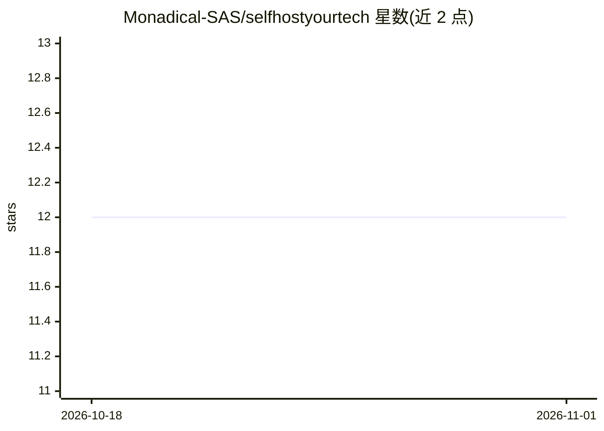

# Monadical-SAS/selfhostyourtech

⭐ 12 · Shell · 推送 2025-12-12 · [GitHub](https://github.com/Monadical-SAS/selfhostyourtech) · [官网](https://selfhostyour.tech) · 组织维护

**面向 1-100 人企业的 Docker 自托管全家桶部署套件**

由 Monadical 维护的一体式 Docker 部署工具包：通过 shtool 命令行与 docker compose 管理器，在单台服务器上部署团队沟通（Zulip）、办公协同（Nextcloud/ONLYOFFICE/HedgeDoc）、CRM 与数据库（Baserow/Twenty）、身份认证（Authentik）、反向代理（Traefik）、发布（Ghost/WordPress）、Git 服务（Gitea）、AI 聊天界面（LibreChat）等应用。提供 DNS 配置指引、Let's Encrypt SSL 配置、prod/dev 双环境与逐应用的数据清理命令。安装以 Ubuntu 为主，其他发行版未提供专门脚本。

## 筛选速览

| 维度 | 判定 | 备注 |
|---|---|---|
| AI 角色 | `ai-enhanced` | 去掉 AI 部分产品仍成立 |
| 许可风险 | `none` | — |
| 部署形态 | `self-host` | docker 或自建部署 |
| 模型依赖 | — | README 未给出锁定关系 |
| 硬件要求 | — | 无带数字的原话,不猜 |
| 安装摩擦 | `low` | 无编译、无系统依赖或容器化 |
| 成熟度 | — | 结构信号不足 |

## 能力要点

- 单仓库统一部署 15 个开箱应用，含 Zulip/Nextcloud/Baserow/Authentik/LibreChat 等
- shtool 管理器支持单服务或全量的启停/部署/数据清理
- Traefik 反向代理 + Let's Encrypt 自动 SSL，支持 prod/dev 双环境
- Homer 仪表盘自动反映已启用应用

## 适用场景

- 小企业在一台服务器上搭建自有数据的全套办公与协作服务
- 通过统一命令行管理多个自托管应用的部署与凭据配置
- 以自托管方式替代 SaaS，保留对数据和服务的控制权

## 场景标签

 · 领域:自托管基础设施/企业IT

## 证据(README 行号)

> L5: SelfHostYour.Tech is an all-in-one Docker kit designed to help businesses self-host their complete tech stack. It's 
> L307: - **LibreChat**

## 星数曲线

2026-10-18 12 → 2026-11-01 12（+0）

---
*卡片 v1 · prompt 1.4 · 生成 2026-11-01 · 置信度 high · 依据 README sha `4f99b3e8808d` · [字段定义](../../DATASET.md)*
