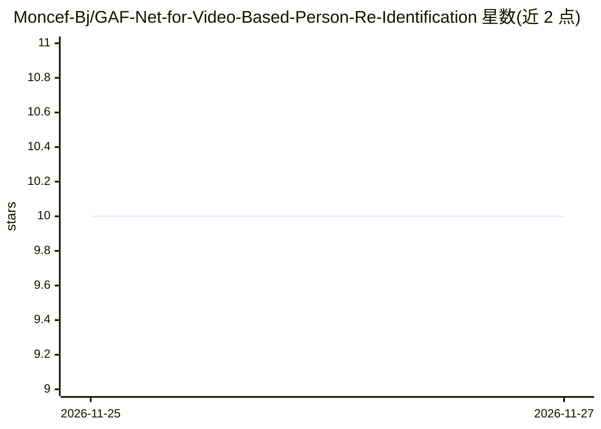

# Moncef-Bj/GAF-Net-for-Video-Based-Person-Re-Identification

⭐ 10 · Python · NOASSERTION · 推送 2026-11-01 · [GitHub](https://github.com/Moncef-Bj/GAF-Net-for-Video-Based-Person-Re-Identification) · 组织维护

**论文官方实现：融合外观与步态特征的视频行人重识别**

GAF-Net（VISAPP 2024）论文的官方 PyTorch 实现，将 RGB tracklet 提取的外观特征与骨骼姿态提取的步态特征融合，用于跨摄像头视频行人重识别。仓库提供预计算外观/步态嵌入、iLIDS-VID 特征拼接评估脚本（报告 CMC 与 mAP）、GaitGraph 在 iLIDS-VID 上的训练代码与姿态数据。限制：不提供外观模型（PiT/MGH/OSNet）训练代码、无端到端推理管线、GaitGraph 预训练权重尚未发布。

## 筛选速览

| 维度 | 判定 | 备注 |
|---|---|---|
| AI 角色 | `ai-native` | 本体是模型或模型工具 |
| 许可风险 | `none` | NOASSERTION |
| 部署形态 | `desktop` | 安装包/桌面程序 |
| 模型依赖 | — | README 未给出锁定关系 |
| 硬件要求 | — | 无带数字的原话,不猜 |
| 安装摩擦 | `low` | 无编译、无系统依赖或容器化 |
| 成熟度 | — | 结构信号不足 |

## 能力要点

- 提供预计算嵌入的 iLIDS-VID 特征拼接评估脚本，报告 Rank-1/5/10 与 mAP
- 融合三种外观骨干（PiT/MGH/OSNet）与 GaitGraph 步态嵌入（λ 可通过 --lambda_val 覆盖）
- 提供 GaitGraph 在 iLIDS-VID 上的两阶段训练代码与 COCO 17 关键点姿态数据

## 适用场景

- 复现 GAF-Net 在 iLIDS-VID 上的特征拼接评估结果
- 基于骨骼姿态数据训练 GaitGraph 步态识别模型
- 研究外观与步态特征融合策略在行人重识别中的效果

## 场景标签

`多模态` `目标检测` `科研工具` · 领域:学习与行业

## 证据(README 行号)

> L9: Official implementation of **GAF-Net: Video-Based Person Re-Identification via Appearance and Gait Recognitions** (V
> L17: Video-based person re-identification (Re-ID) is a challenging task aiming to match individuals across various camer
> L32: This repository supports independently running the VISAPP 2024 iLIDS-VID feature-concatenation evaluation using the

## 星数曲线

2026-11-25 10 → 2026-11-27 10（+0）

---
*卡片 v1 · prompt 1.4 · 生成 2026-11-24 · 置信度 high · 依据 README sha `af4270094c33` · [字段定义](../../DATASET.md)*
