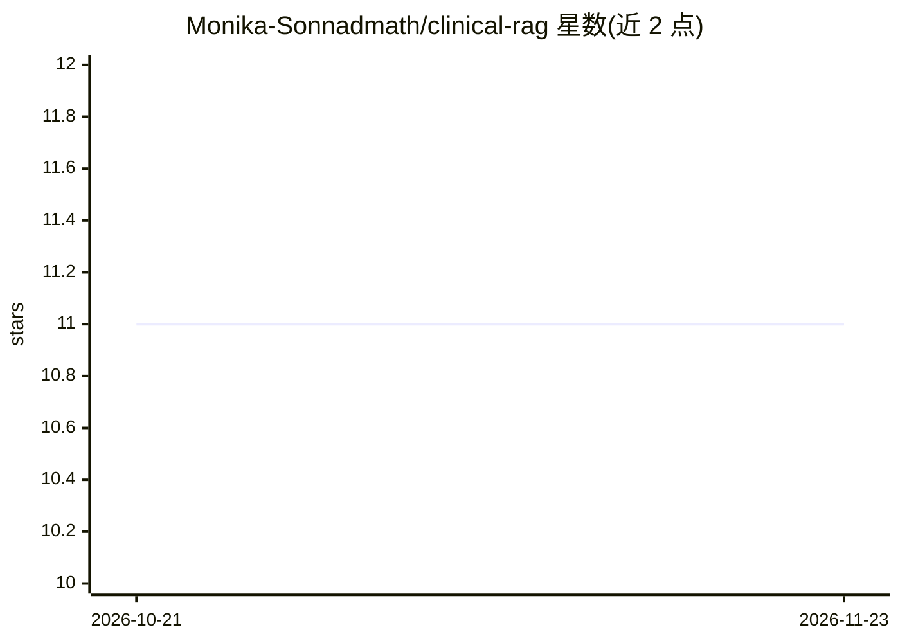

# Monika-Sonnadmath/clinical-rag

⭐ 11 · Python · 推送 2026-06-03 · [GitHub](https://github.com/Monika-Sonnadmath/clinical-rag) · 个人维护

**给临床人员用 AI 问答临床 PDF 文档并给出出处**

基于 Python 与 LangChain 构建的临床文档问答工具：上传临床 PDF（出院小结、转诊信、指南等），用自然语言提问，系统检索文档相关段落并返回带来源引用的回答。默认 temperature 为 0，系统提示明确要求模型不作猜测；答案缺失时明确说明。提供 Streamlit Web UI 与 Python API（ClinicalRAG/RAGConfig），支持持久化向量存储与批量提问。README 声明其非医疗决策支持系统，需对照原文核验。

## 筛选速览

| 维度 | 判定 | 备注 |
|---|---|---|
| AI 角色 | `ai-native` | 本体是模型或模型工具 |
| 许可风险 | `permissive` | — |
| 部署形态 | `library` | 以包/库形式分发 |
| 模型依赖 | — | README 未给出锁定关系 |
| 硬件要求 | — | 无带数字的原话,不猜 |
| 安装摩擦 | `low` | 无编译、无系统依赖或容器化 |
| 成熟度 | — | 结构信号不足 |

## 能力要点

- 上传临床 PDF，自然语言提问并引用出处
- temperature 0 与不许猜测的系统提示
- 持久化向量存储，文档免重复处理
- 提供 Streamlit Web UI 与 Python API

## 适用场景

- 在长篇临床指南里快速定位某个剂量或日期
- 批量提问出院小结提取诊断与随访安排
- 在自己的数据管道里集成文档问答能力

## 场景标签

`文档问答` `RAG` · 领域:知识与检索

## 证据(README 行号)

> L3: **Ask questions about clinical documents using AI — answers grounded in the document, not guesswork.**
> L19: RAG (Retrieval-Augmented Generation) felt like a natural fit. Instead of summarising or rewriting documents — which
> L49: rag = ClinicalRAG(config=RAGConfig(model="gpt-4o-mini"))

## 星数曲线

2026-10-21 11 → 2026-11-23 11（+0）

---
*卡片 v1 · prompt 1.4 · 生成 2026-11-19 · 置信度 high · 依据 README sha `d0ed41bc6d3a` · [字段定义](../../DATASET.md)*
