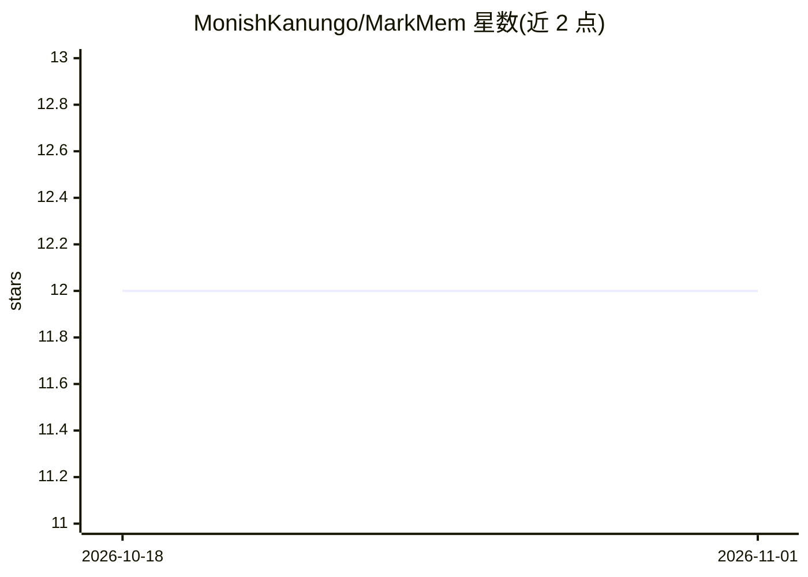

# MonishKanungo/MarkMem

⭐ 12 · Python · Apache-2.0 · 推送 2026-08-20 · [GitHub](https://github.com/MonishKanungo/MarkMem) · [官网](https://pypi.org/project/markmem/) · 个人维护

**聊天机器人记忆层：以 git 仓库中的 markdown 存储记忆**

面向开发者的 Python 记忆层库，将聊天机器人记忆存储为纯 markdown 文件，可用 cat/grep/git diff 直接查看与审计；SQLite 仅作可重建缓存，markmem reindex 可从 markdown 恢复。核心机制包括 YAML 双时态事实（valid_until/supersedes、as_of 查询）、Presidio PII 写入门控、git 作为审计与 GDPR 抹除面（scrub/rewrite/crypto-shred 三种模式）；检索采用 BM25+向量 RRF 融合，LLM 提取经 LiteLLM 支持 100+ 模型，另提供 MCP Server 与 REST API。限制：单仓库约 5-10 万页上限、编译页读写最终一致、FTS5 词干偏向英文。

## 筛选速览

| 维度 | 判定 | 备注 |
|---|---|---|
| AI 角色 | `ai-ecosystem` | LLM/agent 周边工具 |
| 许可风险 | `permissive` | Apache-2.0 |
| 部署形态 | `library` | 以包/库形式分发 |
| 模型依赖 | — | README 未给出锁定关系 |
| 硬件要求 | — | 无带数字的原话,不猜 |
| 安装摩擦 | `low` | 无编译、无系统依赖或容器化 |
| 成熟度 | — | 结构信号不足 |

## 能力要点

- 记忆即 markdown+git：可 cat/grep/diff，SQLite 仅作可重建缓存
- YAML 双时态事实（supersedes/valid_until）支持 as_of 时序查询
- Presidio PII 写入门控与三种 GDPR 抹除模式（scrub/rewrite/crypto-shred）
- BM25+向量 RRF 融合检索，LiteLLM 支持 100+ LLM，含 MCP Server 与 REST API

## 适用场景

- 给聊天机器人加可审计、可 diff 的长期记忆
- 满足 GDPR 用户数据抹除与合规审计需求
- 在 Claude Code/Desktop 中通过 MCP 使用 wiki 记忆
- 从 mem0 导入或导出记忆做迁移

## 场景标签

`Agent 记忆` · 领域:Agent 开发

## 证据(README 行号)

> L5:  A memory layer for chatbots that stores memory as plain markdown in a git repo.
> L29: *(It also includes everything you expect: BM25+Vector RRF fusion, 100+ LLMs via LiteLLM, injection quarantines, an 
> L98: |`add(messages, user_id, agent_id, run_id, metadata)`|PII-gated, enqueued; compiles off the hot path|

## 星数曲线

2026-10-18 12 → 2026-11-01 12（+0）

---
*卡片 v1 · prompt 1.4 · 生成 2026-11-01 · 置信度 high · 依据 README sha `f4f979580bde` · [字段定义](../../DATASET.md)*
