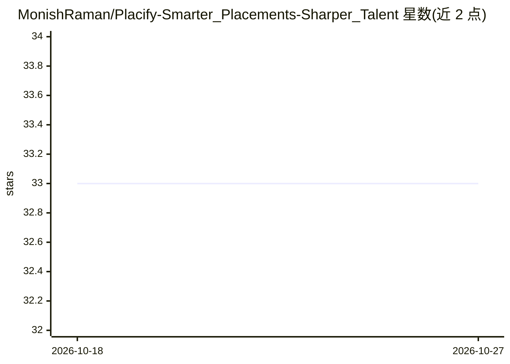

# MonishRaman/Placify-Smarter_Placements-Sharper_Talent

⭐ 33 · JavaScript · MIT · 推送 2025-11-08 · [GitHub](https://github.com/MonishRaman/Placify-Smarter_Placements-Sharper_Talent) · [官网](https://placify-smarter-placements-sharper-gamma.vercel.app) · 组织维护

**面向校园招聘的 AI 面试与技能评估全栈平台**

由学生团队开发的 AI 招聘评估平台，面向学生、院校、HR 与就业指导部门。核心功能包括模拟面试并从表情、语音、技术准确性与行为特征多维度评分，支持自适应出题、简历筛选（ATS）、个性化反馈报告、学习路线建议与招聘方数据看板。技术栈为 React 前端、Node.js/Express 后端（MongoDB/Mongoose）、Python ML 模块（情绪检测、语音分析、答案匹配）。提供 git clone + npm install 的本地运行方式，已有线上演示。

## 筛选速览

| 维度 | 判定 | 备注 |
|---|---|---|
| AI 角色 | `ai-native` | 本体是模型或模型工具 |
| 许可风险 | `permissive` | MIT |
| 部署形态 | `library` | 以包/库形式分发 |
| 模型依赖 | — | README 未给出锁定关系 |
| 硬件要求 | — | 无带数字的原话,不猜 |
| 安装摩擦 | `low` | 无编译、无系统依赖或容器化 |
| 成熟度 | — | 结构信号不足 |

## 能力要点

- AI 面试多维度评分：表情、语音语调、技术准确性、行为特征
- Python ML 模块：情绪检测、语音韵律分析、模糊匹配答案判定、代码质量分析
- 自适应出题与个性化学生反馈报告、AI 学习路线建议
- React + Express + MongoDB 全栈结构，含招聘方数据看板

## 适用场景

- 院校批量自动化校园面试，替代人工初筛
- 学生获取面试表现的个性化反馈与提升路线
- 招聘方通过数据看板查看候选人画像
- 就业指导部门分析学生能力差距改进教学

## 场景标签

`模型评测` `数据分析` · 领域:效率与自动化

## 证据(README 行号)

> L63: **Placify** is an AI-powered, full-stack assessment platform that automates and elevates the campus placement proce
> L115: ├── ml_modules/ # Python ML modules (AI, scoring, analysis)

## 星数曲线

2026-10-18 33 → 2026-10-27 33（+0）

---
*卡片 v1 · prompt 1.4 · 生成 2026-10-25 · 置信度 mid · 依据 README sha `ce7b2291bf08` · [字段定义](../../DATASET.md)*
