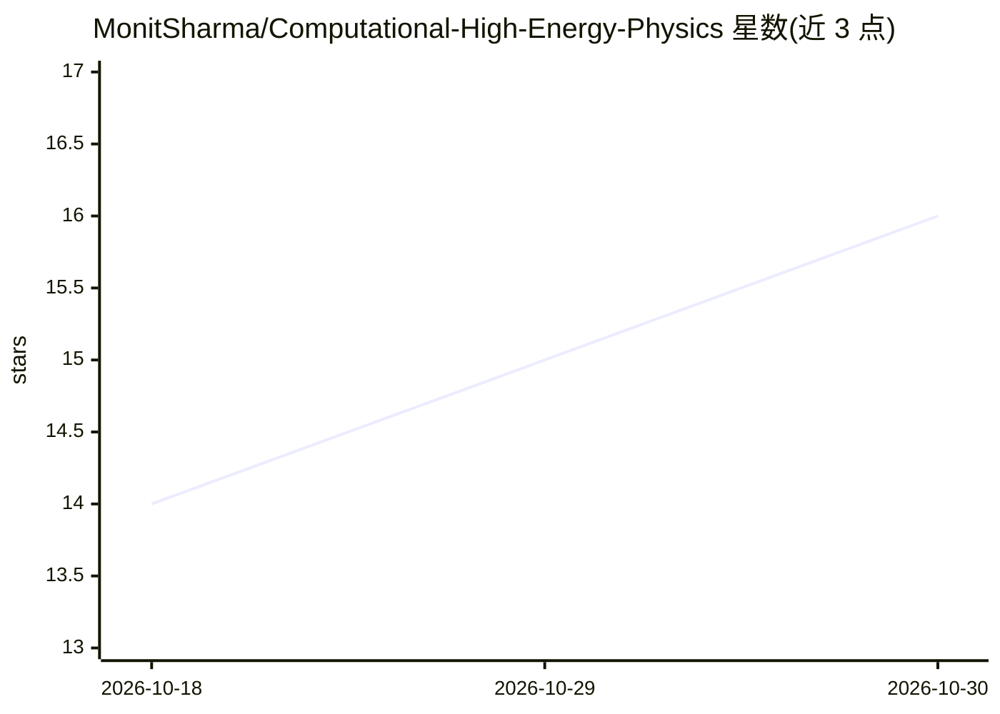

# MonitSharma/Computational-High-Energy-Physics

⭐ 16 · Jupyter Notebook · Apache-2.0 · 推送 2026-08-12 · [GitHub](https://github.com/MonitSharma/Computational-High-Energy-Physics) · [官网](https://monitsharma.github.io/Computational-High-Energy-Physics/) · 个人维护

**高能物理计算代码集合：格点QCD模拟与机器学习项目**

收录计算高能物理领域多个项目的代码合集：基于格点的夸克物质状态方程模拟（含重子数、电荷、奇异性化学势，实现 Noronha-Hostler 等人论文，要求引用）、含 QCD 临界点的 BEST 协作组状态方程程序（3D Ising 普适类参数化）、LHC 机器学习课程作业（径迹识别、粒子鉴别、触发）、基于 Keras 的 CERN 深度学习喷注图像分类与生成，以及 Maria Schuld 在 CERN 的量子计算演示讲义与 Jupyter notebook。面向高能物理研究人员与学生。

## 筛选速览

| 维度 | 判定 | 备注 |
|---|---|---|
| AI 角色 | `ai-native` | 本体是模型或模型工具 |
| 许可风险 | `permissive` | Apache-2.0 |
| 部署形态 | `None` |  |
| 模型依赖 | — | README 未给出锁定关系 |
| 硬件要求 | — | 无带数字的原话,不猜 |
| 安装摩擦 | `low` | 无编译、无系统依赖或容器化 |
| 成熟度 | — | 结构信号不足 |

## 能力要点

- 格点QCD状态方程模拟（有限化学势，实现已发表论文）
- 含QCD临界点的BEST协作组状态方程程序（3D Ising普适类）
- Keras处理CERN数据：喷注图像分类与生成
- CERN量子计算演示的讲义与notebook

## 适用场景

- 重离子碰撞模拟中调用格点QCD状态方程
- 学习LHC数据分析中的机器学习方法
- 入门量子计算在高能物理中的应用

## 场景标签

`教程课程` · 领域:学习与行业

## 证据(README 行号)

> L11: This repository contains projects and code relating to the field of Computational High Energy Physics, ranging from
> L55: In this online course students are introduced into the main concepts of the Physics behind those data flow so the m
> L61: An Introduction to Deep Learning with Keras, focused on using it on data from CERN and classification and generatio

## 星数曲线

2026-10-18 14 → 2026-10-30 16（+2）

---
*卡片 v1 · prompt 1.4 · 生成 2026-10-30 · 置信度 mid · 依据 README sha `ba972af68590` · [字段定义](../../DATASET.md)*
