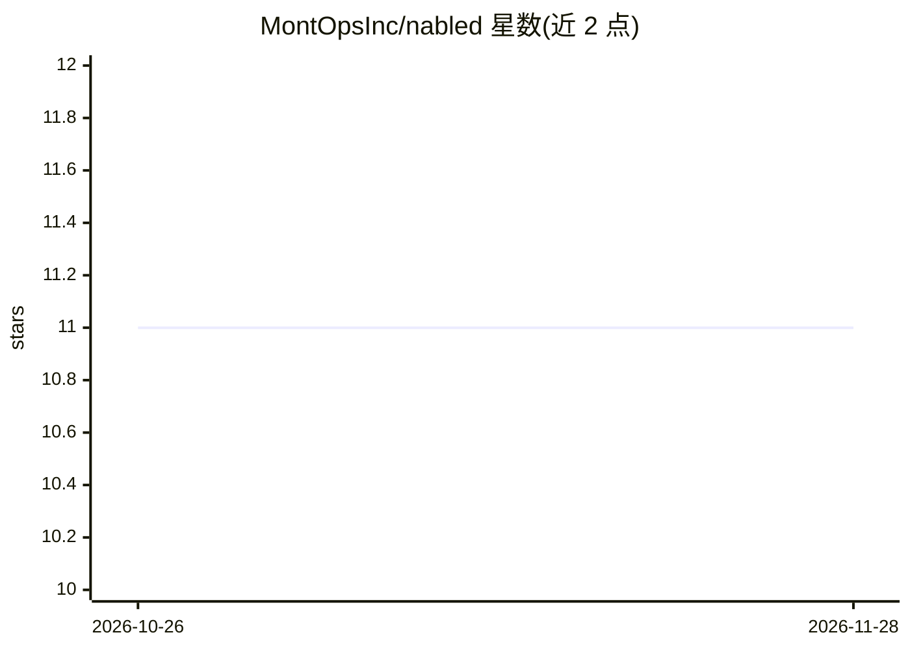

# MontOpsInc/nabled

⭐ 11 · Rust · MIT · 推送 2026-07-28 · [GitHub](https://github.com/MontOpsInc/nabled) · 组织维护

**Rust ndarray 原生线性代数与 ML 矩阵运算库**

基于 ndarray 的 Rust 数值库，面向生产级线性代数与面向 ML 的矩阵/向量运算。已实现域覆盖 SVD/QR/LU/Cholesky/特征分解等分解、矩阵函数、PCA 与回归、稀疏求解、嵌入向量精确 rerank（cosine/dot/L2、top_k、MMR、int8 量化、recall@k/MRR/nDCG 评估），以及物理 AI 域（URDF、运动学/动力学、LQR、卡尔曼滤波）。提供 Cargo 与 maturin 构建的 Python 绑定 pynabled，NumPy/PyArrow 数组可直接调用。API 处于活跃开发期，官方建议固定版本号。

## 筛选速览

| 维度 | 判定 | 备注 |
|---|---|---|
| AI 角色 | `ai-native` | 本体是模型或模型工具 |
| 许可风险 | `permissive` | MIT |
| 部署形态 | `library` | 以包/库形式分发 |
| 模型依赖 | — | README 未给出锁定关系 |
| 硬件要求 | — | 无带数字的原话,不猜 |
| 安装摩擦 | `low` | 无编译、无系统依赖或容器化 |
| 成熟度 | `idea` | |

## 能力要点

- 嵌入向量精确 rerank 层：Metric 枚举、top_k/rerank、brute_force_knn、MMR、int8 量化与离线评估指标
- 物理 AI 特性域：URDF FK/IK、RNEA/CRBA 树动力学、LQR/DARE 控制与卡尔曼/EKF 传感器融合
- Python 绑定 pynabled 经 maturin 构建，NumPy/PyArrow 双面 API，支持 out= 缓冲复用与 typed result 复用
- 可选后端 feature：openblas/netlib/magma-system、accelerator-rayon/wgpu、arrow 零拷贝互操作

## 适用场景

- 在 Rust 项目中做矩阵分解、迭代求解与 PCA/回归等数值计算
- 为向量检索流程补上精确 rerank 步骤（配合已有向量库）
- 机器人学中的运动学/动力学建模与控制计算
- Python 端通过 pynabled 用 NumPy 数组调用同一套线性代数 API

## 场景标签

 · 领域:数值计算/机器学习基础库

## 证据(README 行号)

> L9: Nabled is an ndarray-native Rust numerical library focused on production-grade
> L10: linear algebra and ML-oriented matrix/vector operations.
> L46: 8. Embeddings (`embeddings` feature): a lightweight, ndarray-native,

## 星数曲线

2026-10-26 11 → 2026-11-28 11（+0）

---
*卡片 v1 · prompt 1.4 · 生成 2026-11-19 · 置信度 high · 依据 README sha `af60cca9b3f1` · [字段定义](../../DATASET.md)*
