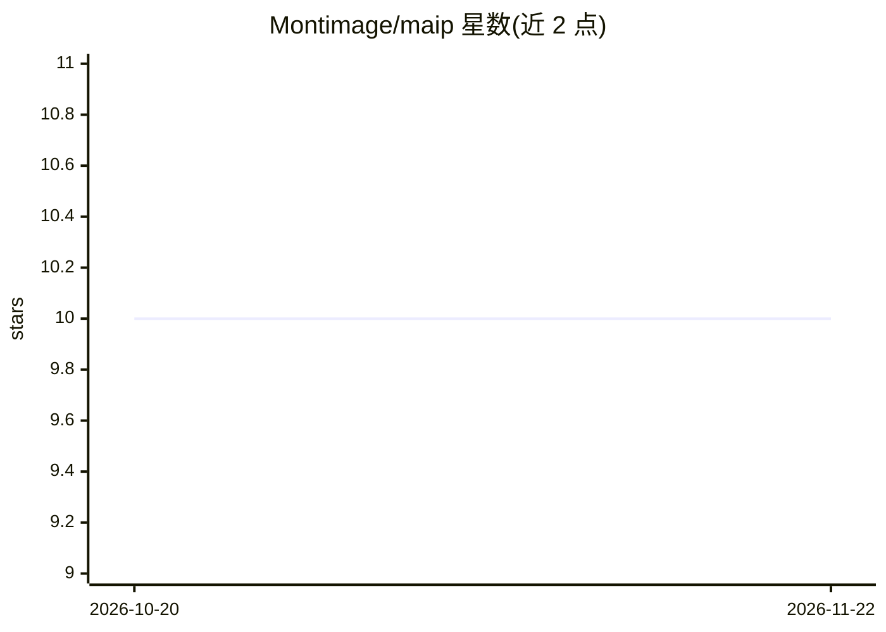

# Montimage/maip

⭐ 10 · JavaScript · Apache-2.0 · 推送 2026-02-17 · [GitHub](https://github.com/Montimage/maip) · 组织维护

**给安全运维人员提供网络威胁检测与可解释 AI 服务的平台**

Montimage AI Platform 面向安全运维人员，提供基于规则与机器学习模型的网络威胁和异常（近）实时检测能力，并支持对抗攻击模拟以评估 AI 模型的鲁棒性与可问责性。集成 SHAP、LIME 等可解释 AI 技术与 LLM，帮助操作者理解告警、识别恶意流量并获取缓解建议；通过与 SOAR 平台集成实现自动化响应。安装方式为 git clone 后使用 Docker 构建。

## 筛选速览

| 维度 | 判定 | 备注 |
|---|---|---|
| AI 角色 | `ai-native` | 本体是模型或模型工具 |
| 许可风险 | `permissive` | Apache-2.0 |
| 部署形态 | `None` |  |
| 模型依赖 | — | README 未给出锁定关系 |
| 硬件要求 | — | 无带数字的原话,不猜 |
| 安装摩擦 | `low` | 无编译、无系统依赖或容器化 |
| 成熟度 | — | 结构信号不足 |

## 能力要点

- 规则检测与机器学习模型结合的网络威胁/异常检测
- 集成 SHAP、LIME 可解释 AI 技术与 LLM 辅助告警解读
- 支持对抗攻击模拟以评估模型鲁棒性
- 与 SOAR 平台集成实现自动化响应

## 适用场景

- 对网络基础设施进行实时威胁与异常检测
- 解释安全告警并识别恶意流量
- 评估 AI 检测模型对对抗攻击的鲁棒性
- 通过 SOAR 集成自动化安全响应流程

## 场景标签

`网络安全` · 领域:学习与行业

## 证据(README 行号)

> L1: # Montimage AI Platform (MAIP)
> L2: MAIP enables security operators to protect network infrastructures using rule-based detection and advanced machine l

## 星数曲线

2026-10-20 10 → 2026-11-22 10（+0）

---
*卡片 v1 · prompt 1.4 · 生成 2026-11-20 · 置信度 mid · 依据 README sha `af89b5405f75` · [字段定义](../../DATASET.md)*
