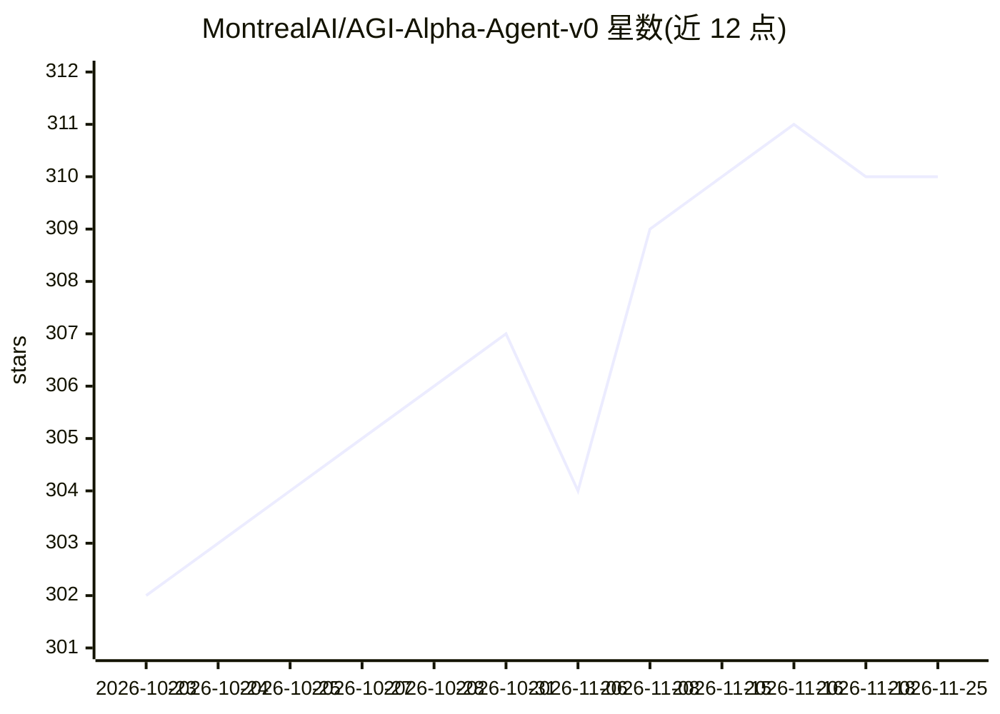

# MontrealAI/AGI-Alpha-Agent-v0

⭐ 310 · Python · Apache-2.0 · 推送 2026-10-29 · [GitHub](https://github.com/MontrealAI/AGI-Alpha-Agent-v0) · [官网](https://montrealai.github.io/AGI-Alpha-Agent-v0/) · 组织维护

**面向研究者与 agent 开发者的 AGI 架构研究论文集与配套实验工具**

该仓库由 MONTREAL.AI 维护，主体是一组 AGI/多智能体架构研究论文（AGI ALPHA 基础架构、Mission-Sovereign Successor、SUCCESSOR Ω、Out-Learn/Out-Think 等 companion papers），论文明确声明其为可检验的设计提案而非已实现的通用智能。仓库另含可运行部分：本地对比两个 CSV 列表并生成带来源引用的行动计划（浏览器内免费、无需账号/API key），以及使用 Computer Use 调查公开材料、产出工作成果的旗舰流程（规划免费，执行需另行配置模型与隔离 runner）。

## 筛选速览

| 维度 | 判定 | 备注 |
|---|---|---|
| AI 角色 | `ai-native` | 本体是模型或模型工具 |
| 许可风险 | `permissive` | Apache-2.0 |
| 部署形态 | `self-host` | docker 或自建部署 |
| 模型依赖 | — | README 未给出锁定关系 |
| 硬件要求 | — | 无带数字的原话,不猜 |
| 安装摩擦 | `low` | 无编译、无系统依赖或容器化 |
| 成熟度 | — | 结构信号不足 |

## 能力要点

- AGI ALPHA 论文提出跨 agents/jobs/validators/tools/memory 的架构与评估方案
- 本地 CSV 对比工具：无账号、无安装、无 API key，可导出行动计划与离线工作区
- 旗舰流程使用 Computer Use 产出具体工作成果，保留尝试、证据与经验
- 多篇 companion paper 附 TeX 源包与交互式 foundry 资源

## 适用场景

- 阅读可检验的多智能体治理与能力制造架构设计
- 在浏览器中免费对比两份列表并生成带来源的行动计划
- 了解论文声明的保留失败与未验证边界（如热量计误差、未运行部署）

## 场景标签

`多智能体` `GUI 自动化` · 领域:Agent 开发

## 证据(README 行号)

> L6: Compare two nonpersonal CSV lists locally, see missing matches and conflicting values, and group every
> L15: **MONTREAL.AI FLAGSHIP · Computer Use · Level 3 strategy development · Level 4 problem reframing**
> L17: Find a valuable opportunity in software, research or mathematics. Use Computer Use to investigate real public

## 星数曲线

2026-10-23 302 → 2026-11-25 310（+8）

---
*卡片 v1 · prompt 1.4 · 生成 2026-11-25 · 置信度 mid · 依据 README sha `88d8e848ab8d` · [字段定义](../../DATASET.md)*
