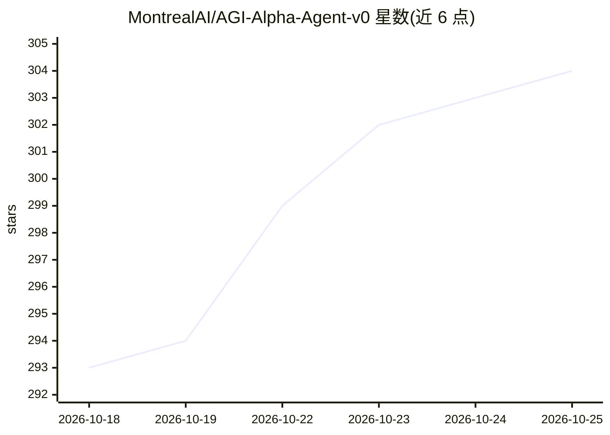

# MontrealAI/AGI-Alpha-Agent-v0

⭐ 304 · Python · Apache-2.0 · 推送 2026-10-24 · [GitHub](https://github.com/MontrealAI/AGI-Alpha-Agent-v0) · [官网](https://montrealai.github.io/AGI-Alpha-Agent-v0/) · 组织维护

**面向开发者的 agentic 工作框架：机会发现到执行与留痕**

Montreal.AI 旗舰仓库，围绕 'Find your Alpha → Build SUCCESSOR Ω' 的工作循环：识别软件/研究/数学机会，用 Computer Use（截图+键鼠）在隔离 Chromium runner 中调查公开材料并产出工作成果，配合策略比较（Level 3）与问题重构（Level 4），保留证据与历史于单一项目。浏览器规划免费且不调用模型；执行需单独配置原生模型与隔离 runner。附带跨行业机会比较 demo（python -m 命令）、26 个 demo 目录、AGI Jobs 委托/评审/结算（USDC）与以太坊主网 $AGIALPHA 合约生态。合同部署记录明确声明不构成上线生产批准。

## 筛选速览

| 维度 | 判定 | 备注 |
|---|---|---|
| AI 角色 | `ai-ecosystem` | LLM/agent 周边工具 |
| 许可风险 | `permissive` | Apache-2.0 |
| 部署形态 | `self-host` | docker 或自建部署 |
| 模型依赖 | local-ok | 支持本地模型 |
| 硬件要求 | — | 无带数字的原话,不猜 |
| 安装摩擦 | `low` | 无编译、无系统依赖或容器化 |
| 成熟度 | — | 结构信号不足 |

## 能力要点

- Computer Use 执行路径：截图+键鼠操作，隔离 Chromium runner，imports 保留观察记录
- 策略比较 demo：输入 JSON 输出排名、排除项、证据与 Pareto 权衡
- 项目全程留痕：尝试、证据、教训保留在单一项目内
- AGI Jobs 委托/评审/USDC 结算与以太坊 $AGIALPHA 合约记录

## 适用场景

- 在隔离环境中调查软件/研究/数学机会并产出带证据的成果
- 运行跨行业机会比较并导出可复现证据
- 通过 AGI Jobs 委托、评审并以 USDC 结算任务

## 场景标签

`浏览器自动化` `Agent 框架` · 领域:Agent 开发

## 证据(README 行号)

> L5: Find a valuable opportunity in software, research or mathematics. Use Computer Use to investigate real public
> L63: > Browser preparation makes no model call. Execution uses the separately configured native model and isolated
> L77: python -m alpha_factory_v1.demos.cross_industry_alpha_factory.opportunity_comparison --example

## 星数曲线

2026-10-18 293 → 2026-10-25 304（+11）

---
*卡片 v1 · prompt 1.4 · 生成 2026-10-21 · 置信度 low · 依据 README sha `35cd37d9cdbf` · [字段定义](../../DATASET.md)*
