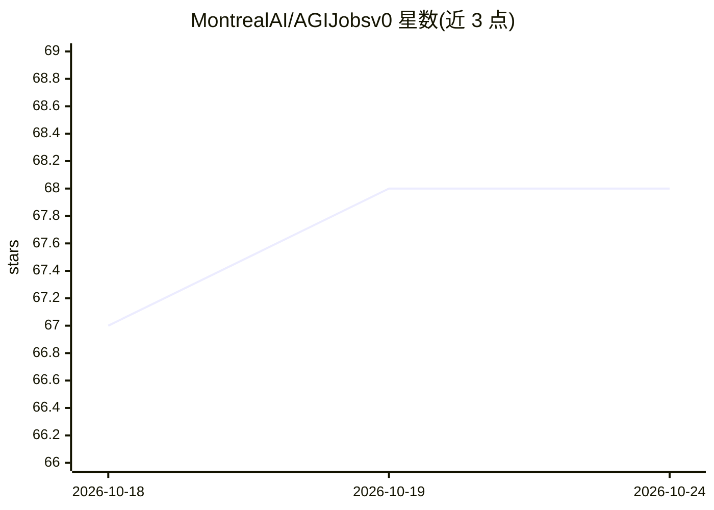

# MontrealAI/AGIJobsv0

⭐ 68 · JavaScript · MIT · 推送 2026-10-24 · [GitHub](https://github.com/MontrealAI/AGIJobsv0) · [官网](https://montrealai.github.io/AGIJobsv0/) · 组织维护

**链上可验证 AI 代理任务工作流系统：任务合约、验证与结算**

面向 AGI 代理工作的综合工作流系统，聚合任务合约、代理网关、验证器、操作员控制台、编排与模拟演示，目标是支持可验证的代理工作与所有者可控治理。基于 Ethereum 合约部署（$AGIALPHA 代币，已记录 25 个 Jobs 合约），提供任务规划器、证据审查器、生产演练（npm run production:rehearse）及所有者命令（暂停、参数重配置、升级队列、多签交易包）。声明多次强调：本地测试不构成主网上线认证，合约当前以暂停状态部署，实际运营需另行授权与验收。

## 筛选速览

| 维度 | 判定 | 备注 |
|---|---|---|
| AI 角色 | `ai-ecosystem` | LLM/agent 周边工具 |
| 许可风险 | `permissive` | MIT |
| 部署形态 | `library` | 以包/库形式分发 |
| 模型依赖 | — | README 未给出锁定关系 |
| 硬件要求 | — | 无带数字的原话,不猜 |
| 安装摩擦 | `low` | 无编译、无系统依赖或容器化 |
| 成熟度 | `idea` | |

## 能力要点

- 任务合约 + 代理网关 + 验证器 + 操作员控制台的组合架构
- npm run production:rehearse 生成含加密检查、故障注入的签名演练报告
- 所有者命令体系：治理姿态验证、系统暂停、参数矩阵、升级队列、多签安全包
- 版本固定的 Ethereum 主网部署记录（25 个 Jobs 合约、8 个托管模块暂停）

## 适用场景

- 为 AI 代理任务设计可验证的交付与验收流程
- 运营者通过命令中心管理与审计链上治理
- 本地演练生产门槛后再评估部署

## 场景标签

 · 领域:AI 代理基础设施/区块链

## 证据(README 行号)

> L46: AGI Jobs v0 (v2) brings together job contracts, agent gateways, validators, operator consoles, orchestration, simul
> L60: **Coordinate computer-based work:** the computer-work integration connects admitted jobs to isolated OpenClaw worke
> L64: **Prepare a deployment:** use the current Hardhat guide or the plain-language coordinator guide. Start with `npm ru

## 星数曲线

2026-10-18 67 → 2026-10-24 68（+1）

---
*卡片 v1 · prompt 1.4 · 生成 2026-10-24 · 置信度 mid · 依据 README sha `9bf08a3fecfc` · [字段定义](../../DATASET.md)*
