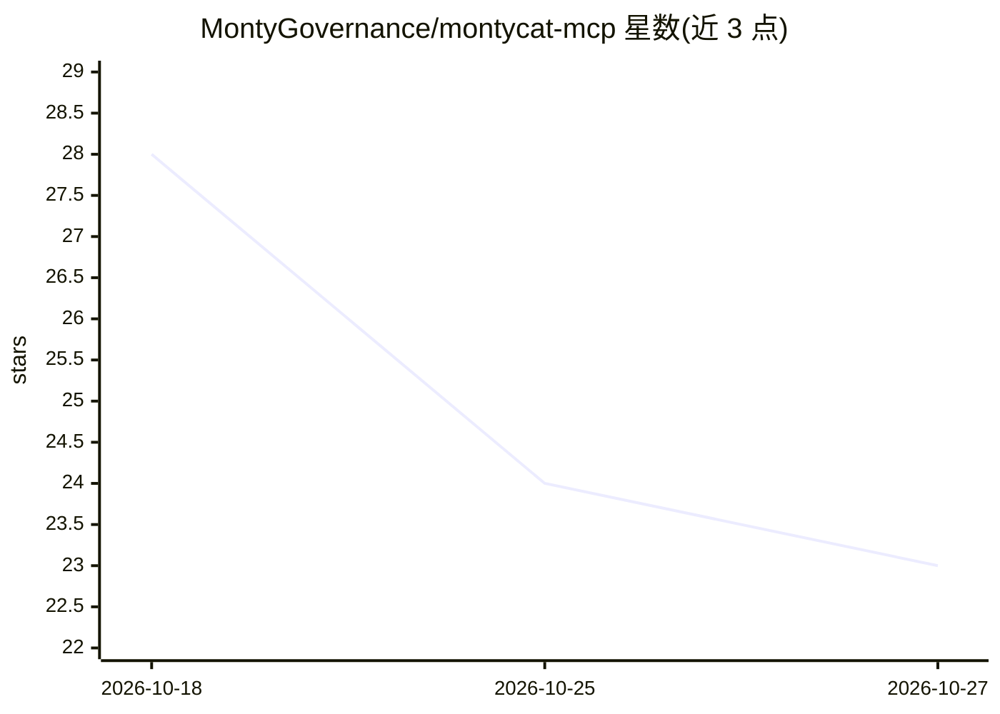

# MontyGovernance/montycat-mcp

⭐ 23 · Python · MIT · 推送 2026-10-04 · [GitHub](https://github.com/MontyGovernance/montycat-mcp) · [官网](https://montygovernance.com/docs) · 组织维护

**自托管 MCP 服务器：为 AI agents 提供共享持久记忆**

自托管的 Model Context Protocol 服务器，使 Claude、Codex、Cursor 等多个 MCP 客户端读写同一份持久记忆。检索支持向量语义搜索、BM25 关键词与混合模式，并提供精确键与元数据查找；服务、引擎与嵌入均在本机运行，无云端托管。提供记忆存取/更新/删除/命名空间管理等 MCP 工具，支持跨 agent 写入等待。限制：scope 是命名空间而非安全边界，需最小权限凭据隔离。

## 筛选速览

| 维度 | 判定 | 备注 |
|---|---|---|
| AI 角色 | `ai-ecosystem` | LLM/agent 周边工具 |
| 许可风险 | `permissive` | MIT |
| 部署形态 | `self-host` | docker 或自建部署 |
| 模型依赖 | locked-api |  |
| 硬件要求 | — | 无带数字的原话,不猜 |
| 安装摩擦 | `low` | 无编译、无系统依赖或容器化 |
| 成熟度 | — | 结构信号不足 |

## 能力要点

- 多 MCP 客户端共享同一份持久记忆
- 向量语义/BM25/混合三种检索模式
- 服务端、引擎与嵌入全部本地运行，无云端依赖
- 提供 Docker 镜像与 Claude Desktop 一键安装包

## 适用场景

- 让不同 AI 编码工具共享团队决策与项目上下文
- 跨会话保留对话中产生的决定和偏好
- 多 agent 通过记忆监听工具协作，无需轮询

## 场景标签

`Agent 记忆` `多智能体` · 领域:Agent 开发

## 证据(README 行号)

> L5: **A self-hosted MCP server that gives AI agents persistent, searchable memory.**
> L6: Claude, Codex, Cursor, and any Model Context Protocol client write to one
> L35: **Codex, Cursor, other MCP clients** — point your client's stdio config at

## 星数曲线

2026-10-18 28 → 2026-10-27 23（-5）

---
*卡片 v1 · prompt 1.4 · 生成 2026-10-27 · 置信度 high · 依据 README sha `31b0da7ecb9c` · [字段定义](../../DATASET.md)*
