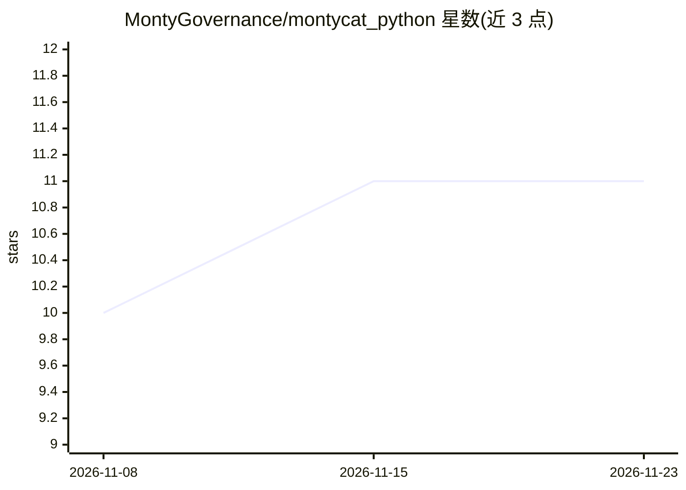

# MontyGovernance/montycat_python

⭐ 11 · Python · MIT · 推送 2026-11-02 · [GitHub](https://github.com/MontyGovernance/montycat_python) · [官网](https://montygovernance.com) · 组织维护

**自托管 NoSQL+向量数据库 Montycat 的异步 Python 客户端**

Montycat 官方异步 Python 客户端，连接一个 Rust 编写的自托管服务端：同一引擎内提供 NoSQL 键值存储与向量/语义检索（kNN）、BM25 关键词与混合排序（RRF 融合），面向 RAG、AI agent 记忆与 LLM 应用。嵌入引擎（ONNX，bge-small 模型）内置于 semantic 版服务端，无需外部嵌入 API；也支持自带预计算向量（1–4,096 维）。服务端经 Docker 镜像、apt 或预编译包获取，客户端 pip 安装；语义搜索需 semantic 版服务端，默认精简版不含。

## 筛选速览

| 维度 | 判定 | 备注 |
|---|---|---|
| AI 角色 | `ai-ecosystem` | LLM/agent 周边工具 |
| 许可风险 | `permissive` | MIT |
| 部署形态 | `self-host` | docker 或自建部署 |
| 模型依赖 | — | README 未给出锁定关系 |
| 硬件要求 | — | 无带数字的原话,不猜 |
| 安装摩擦 | `low` | 无编译、无系统依赖或容器化 |
| 成熟度 | — | 结构信号不足 |

## 能力要点

- 同一引擎提供 NoSQL 存储与语义/BM25/混合三种检索模式
- 嵌入引擎内置于服务端，embedding 不离开本机，无需外部 API 与 key
- 支持自带预计算向量与 Pinecone/Qdrant 风格迁移场景
- 全异步 asyncio 客户端，统一响应信封与连接池

## 适用场景

- 为 LLM 应用搭建自托管的 RAG 语义检索后端
- 给 AI agent / 聊天机器人存长期记忆
- 按语义而非关键词做商品搜索与推荐
- 把分散在多个向量库和数据库中的数据合并到单引擎

## 场景标签

`向量数据库` `RAG` `Agent 记忆` `语义搜索` · 领域:Agent 开发

## 证据(README 行号)

> L5: The official async Python client for Montycat — a self-hosted **NoSQL + vector database** with AI **semantic search*
> L25: For a generation we were told the price of intelligence was two systems: a database for your records, and a separat
> L94: Montycat provides semantic vector search, persistent BM25 keyword search, and

## 星数曲线

2026-11-08 10 → 2026-11-23 11（+1）

---
*卡片 v1 · prompt 1.4 · 生成 2026-11-19 · 置信度 high · 依据 README sha `cd92c169dbde` · [字段定义](../../DATASET.md)*
