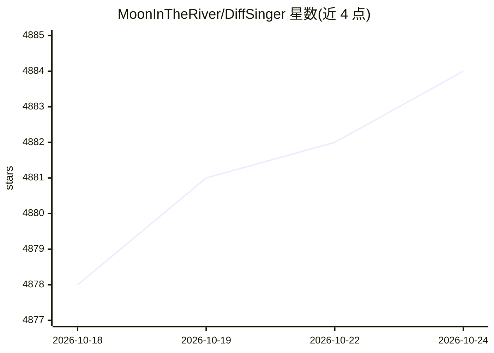

# MoonInTheRiver/DiffSinger

⭐ 4,884 · Python · MIT · 推送 2026-07-24 · [GitHub](https://github.com/MoonInTheRiver/DiffSinger) · 组织维护 · 中文 README

**AAAI 2022 论文官方实现：浅层扩散机制的歌声与语音合成**

AAAI-2022 论文 DiffSinger 的官方 PyTorch 实现，基于浅层扩散机制（Shallow Diffusion）实现歌声合成（SVS）与文本转语音（DiffSpeech/TTS）。支持多种变体：MIDI/F0 输入、隐式/显式音高预测、PNDM 加速采样，声码器采用 NSF-HiFiGAN/HiFiGAN；训练数据集包括 PopCS、OpenCpop 与 Ljspeech。面向科研复现与二次开发，提供 conda/venv 环境搭建说明与 tensorboard 训练监控，未在 README 内给出完整安装包或桌面构建。

## 筛选速览

| 维度 | 判定 | 备注 |
|---|---|---|
| AI 角色 | `ai-native` | 本体是模型或模型工具 |
| 许可风险 | `permissive` | MIT |
| 部署形态 | `library` | 以包/库形式分发 |
| 模型依赖 | — | README 未给出锁定关系 |
| 硬件要求 | — | 无带数字的原话,不猜 |
| 安装摩擦 | `medium` | 含编译或系统依赖之一 |
| 成熟度 | — | 结构信号不足 |

## 能力要点

- 浅层扩散机制实现 Lyric+F0/MIDI 到歌声波形的合成
- PNDM 即插即用加速采样（ICLR 2022）
- 多数据集变体：PopCS、OpenCpop、Ljspeech 的管线与声码器配置表
- 发布 PopCS 数据集并提供 HuggingFace 在线 TTS/SVS 试用

## 适用场景

- 复现 AAAI-2022 论文的歌声合成实验
- 基于 MIDI 与歌词输入合成歌声
- 研究扩散模型在语音/歌声合成中的加速方案

## 场景标签

`语音合成` · 领域:内容生成

## 证据(README 行号)

> L8: This repository is the official PyTorch implementation of our AAAI-2022 paper, in which we propose DiffSinger (for S
> L50: |DiffSpeech (Text->F0, Text+F0->Mel, Mel->Wav)|Ljspeech|None|Explicit|Shallow Diffusion|HiFiGAN|

## 星数曲线

2026-10-18 4,878 → 2026-10-24 4,884（+6）

---
*卡片 v1 · prompt 1.4 · 生成 2026-10-20 · 置信度 high · 依据 README sha `0d88be925bc6` · [字段定义](../../DATASET.md)*
