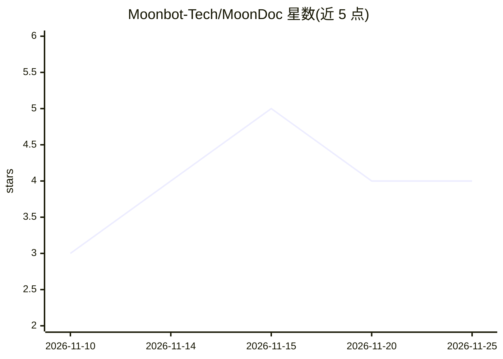

# Moonbot-Tech/MoonDoc

⭐ 4 · Python · NOASSERTION · 推送 2026-11-08 · [GitHub](https://github.com/Moonbot-Tech/MoonDoc) · [官网](https://moonbot.pro) · 组织维护

**面向加密货币剥头皮交易者的 Moonbot 终端文档知识库**

Moonbot 加密剥头皮交易终端的官方文档仓库，内容分三部分：终端机制与交易算法概念（8 章）、可导入的策略模板（标准导入格式配置块）、含 484+ 参数的完整技术参考。仓库另提供面向 AI 助手的现成上下文，用于让用户借助 LLM 配置和检查交易策略。文档覆盖 Binance、Bybit、OKX 等 7 家交易所的现货与合约，终端本身为 Windows 程序，含 Demo/Free/PRO 三个版本。

## 筛选速览

| 维度 | 判定 | 备注 |
|---|---|---|
| AI 角色 | `ai-knowledge` | 知识聚合/清单类 |
| 许可风险 | `none` | NOASSERTION |
| 部署形态 | `None` |  |
| 模型依赖 | — | README 未给出锁定关系 |
| 硬件要求 | — | 无带数字的原话,不猜 |
| 安装摩擦 | `low` | 无编译、无系统依赖或容器化 |
| 成熟度 | — | 结构信号不足 |

## 能力要点

- 提供供 AI 助手使用的策略配置上下文（LLM-ready guide）
- 23 种策略类型、480+ 配置参数的完整技术参考
- 标准导入格式的现成策略模板库，含交易思路拆解
- 含自 2019 年起的用户交易量与订单统计档案

## 适用场景

- 想借助 AI 助手生成或检查 Moonbot 策略配置
- 按章节学习剥头皮、行情侦测与自动交易机制
- 复制现成策略模板后按需调整参数

## 场景标签

`金融量化` · 领域:学习与行业

## 证据(README 行号)

> L91: The knowledge base in this repository is split into two complementary parts:
> L93: 2. **Technical reference of parameters, formulas and protocols (`reference/`)** — contains exact specifications of 
> L38: |**Use the parameter reference or connect an AI**|Use the Technical reference (`reference/`) and the ready-made con

## 星数曲线

2026-11-10 3 → 2026-11-25 4（+1）

---
*卡片 v1 · prompt 1.4 · 生成 2026-11-21 · 置信度 high · 依据 README sha `947bb0234b83` · [字段定义](../../DATASET.md)*
