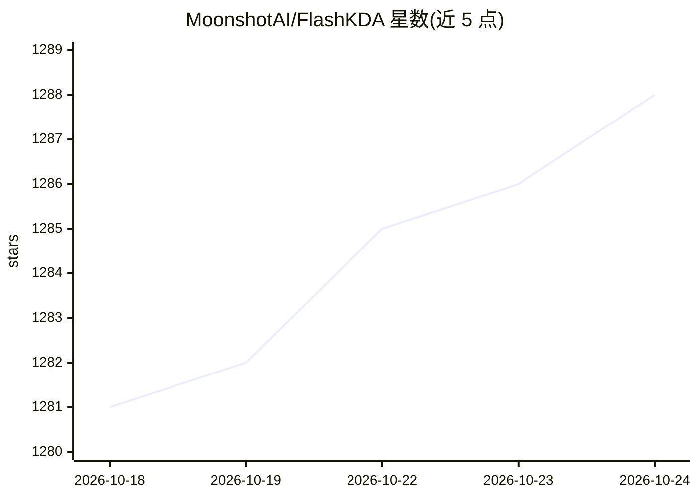

# MoonshotAI/FlashKDA

⭐ 1,289 · Cuda · MIT · 推送 2026-09-01 · [GitHub](https://github.com/MoonshotAI/FlashKDA) · 组织维护

**为 Kimi Delta Attention 提供基于 CUTLASS 的 CUDA 算子库**

MoonshotAI 开源的 Kimi Delta Attention（KDA）CUDA kernel 库，基于 CUTLASS 构建，要求 SM90 及以上 GPU、CUDA 12.9+ 与 PyTorch 2.4+，源码编译安装。可被 flash-linear-attention >= 0.5.0 的 chunk_kda 自动调度作为后端，也可通过设置 FLA_FLASH_KDA=0 回退到 Triton 路径。提供 flash_kda.fwd 算子 API（当前要求 K=V=128，支持变长序列 cu_seqlens 与初始/最终循环状态），并附正确性测试与 H20 基准文档。

## 筛选速览

| 维度 | 判定 | 备注 |
|---|---|---|
| AI 角色 | `ai-ecosystem` | LLM/agent 周边工具 |
| 许可风险 | `permissive` | MIT |
| 部署形态 | `library` | 以包/库形式分发 |
| 模型依赖 | — | README 未给出锁定关系 |
| 硬件要求 | — | 无带数字的原话,不猜 |
| 安装摩擦 | `medium` | 含编译或系统依赖之一 |
| 成熟度 | — | 结构信号不足 |

## 能力要点

- 基于 CUTLASS 的 KDA 前向 CUDA kernel（flash_kda.fwd）
- 作为 flash-linear-attention 的 chunk_kda 后端被自动调度
- 支持变长序列（cu_seqlens）与 bf16/fp32 循环状态传入/输出
- 编译时自动检测当前 GPU 架构，可指定多架构编译

## 适用场景

- 在 SM90 及以上 GPU 上为 KDA 注意力替换 Triton 实现以获得 CUTLASS kernel
- 在 flash-linear-attention 流水线中直接调用 chunk_kda 使用该后端
- 需要变长序列批处理与循环状态管理的推理场景

## 场景标签

`推理引擎` · 领域:训练与推理

## 证据(README 行号)

> L3: FlashKDA: Flash Kimi Delta Attention — high-performance KDA kernels built on CUTLASS
> L32: Once installed, FlashKDA is auto-dispatched from `flash-linear-attention`'s `chunk_kda`. See fla-org/flash-linear-a

## 星数曲线

2026-10-18 1,281 → 2026-10-24 1,288（+7）

---
*卡片 v1 · prompt 1.4 · 生成 2026-10-21 · 置信度 mid · 依据 README sha `1207e1db7c67` · [字段定义](../../DATASET.md)*
