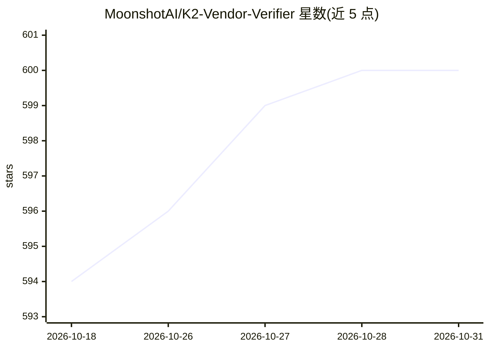

# MoonshotAI/K2-Vendor-Verifier

⭐ 600 · Python · 推送 2026-02-14 · [GitHub](https://github.com/MoonshotAI/K2-Vendor-Verifier) · 组织维护 · 中文 README

**Kimi K2 各 API 供应商 toolcall 精度评测工具与榜单**

由 MoonshotAI 发布的评测工具与结果榜单：针对 kimi-k2-thinking 与 kimi-k2-0905 模型，向各 API 供应商发送 4,000 条请求，与官方 Moonshot API 对比，以 tool_call_f1（触发相似度）与 schema_accuracy（JSON 结构合规率）两项指标衡量各供应商部署的正确性，并周期性更新榜单。附带的 tool_calls_eval.py 脚本支持用户以任意 base-url、OpenRouter 或自部署 vLLM/SGLang 端点自行复现评测，README 同时给出供应商修正部署的建议（版本选择、tool call ID 重命名、guided encoding）。

## 筛选速览

| 维度 | 判定 | 备注 |
|---|---|---|
| AI 角色 | `ai-ecosystem` | LLM/agent 周边工具 |
| 许可风险 | `none` | — |
| 部署形态 | `None` |  |
| 模型依赖 | — | README 未给出锁定关系 |
| 硬件要求 | — | 无带数字的原话,不猜 |
| 安装摩擦 | `low` | 无编译、无系统依赖或容器化 |
| 成熟度 | — | 结构信号不足 |

## 能力要点

- tool_call_f1 与 schema_accuracy 双指标评测各 K2 API 供应商
- 提供 tool_calls_eval.py 供用户自行复现评测（含 OpenRouter、并发、增量模式等参数）
- 覆盖 kimi-k2-thinking 与 kimi-k2-0905 两期榜单，与官方 API 对比
- 对供应商给出部署修正建议（推理引擎版本、tool call ID 格式、guided encoding）

## 适用场景

- 在多个 Kimi K2 API 供应商之间按 toolcall 精度做选型参考
- 自行评测自部署或第三方 K2 端点的 toolcall 表现
- 供应商排查部署问题（版本、tool ID 格式、JSON schema 约束）

## 场景标签

`模型评测` · 领域:评测与运维

## 证据(README 行号)

> L12: To mitigate these problems, we launch K2 Vendor Verifier to monitor and enhance the quality of all K2 APIs.
> L273: We test toolcall's response over a set of 4,000 requests. Each provider's responses are collected and compared aga

## 星数曲线

2026-10-18 594 → 2026-10-31 600（+6）

---
*卡片 v1 · prompt 1.4 · 生成 2026-10-21 · 置信度 high · 依据 README sha `9adec8829825` · [字段定义](../../DATASET.md)*
