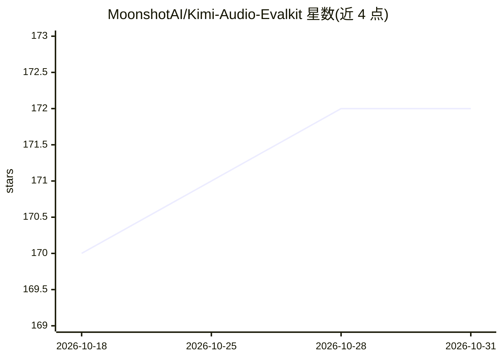

# MoonshotAI/Kimi-Audio-Evalkit

⭐ 172 · Python · MIT · 推送 2025-11-20 · [GitHub](https://github.com/MoonshotAI/Kimi-Audio-Evalkit) · 组织维护 · 中文 README

**音频大语言模型评测框架：跑基准、出指标报告**

MoonshotAI 开源的音频大语言模型评测框架（ALMEvalKit），支持 Baichuan-Audio、Qwen2-Audio、Qwen2.5-Omni、GLM4-Voice、StepAudio、Kimi-Audio 等模型的推理与评测，覆盖 ASR、MQA、OpenQA、RefQA 四类共约 20 个数据集。通过 git clone 获取源码并配合预构建 Docker 镜像运行，以 run_audio.sh 为入口，推理与评测可分离执行；默认评测模型为 gpt-4o-mini，需自设 OpenAI API key。用户可通过 jsonl 文件与继承数据集父类添加自定义数据集，实现 generate_inner 方法接入自有模型。

## 筛选速览

| 维度 | 判定 | 备注 |
|---|---|---|
| AI 角色 | `ai-ecosystem` | LLM/agent 周边工具 |
| 许可风险 | `permissive` | MIT |
| 部署形态 | `self-host` | docker 或自建部署 |
| 模型依赖 | — | README 未给出锁定关系 |
| 硬件要求 | — | 无带数字的原话,不猜 |
| 安装摩擦 | `low` | 无编译、无系统依赖或容器化 |
| 成熟度 | — | 结构信号不足 |

## 能力要点

- 支持 6 个系列音频大模型的推理与评测，Kimi-Audio 即用本框架评测
- 覆盖 ASR/MQA/OpenQA/RefQA 四类数据集，含 LibriSpeech、AISHELL、WenetSpeech 等
- 推理与评测分离执行（--skip-eval / --reeval），便于复用 GPU 推理结果
- 通过 jsonl 与继承父类添加自定义数据集，实现 generate_inner 接入自有模型

## 适用场景

- 对音频大模型跑多数据集基准并生成指标报告
- 将自己的音频模型/数据集接入评测并与其他开源模型对比
- 只跑推理或只重算评测指标，复用已有推理结果

## 场景标签

`模型评测` · 领域:评测与运维

## 证据(README 行号)

> L7: Kimi-Audio-Evalkit is an evaluation framework designed for audio large language models. Based on Kimi-Audio-Evalkit,
> L147: We hope the community can work together to build a fair, efficient, and unified audio large language model evaluat

## 星数曲线

2026-10-18 170 → 2026-10-31 172（+2）

---
*卡片 v1 · prompt 1.4 · 生成 2026-10-22 · 置信度 high · 依据 README sha `688301ff5dd2` · [字段定义](../../DATASET.md)*
