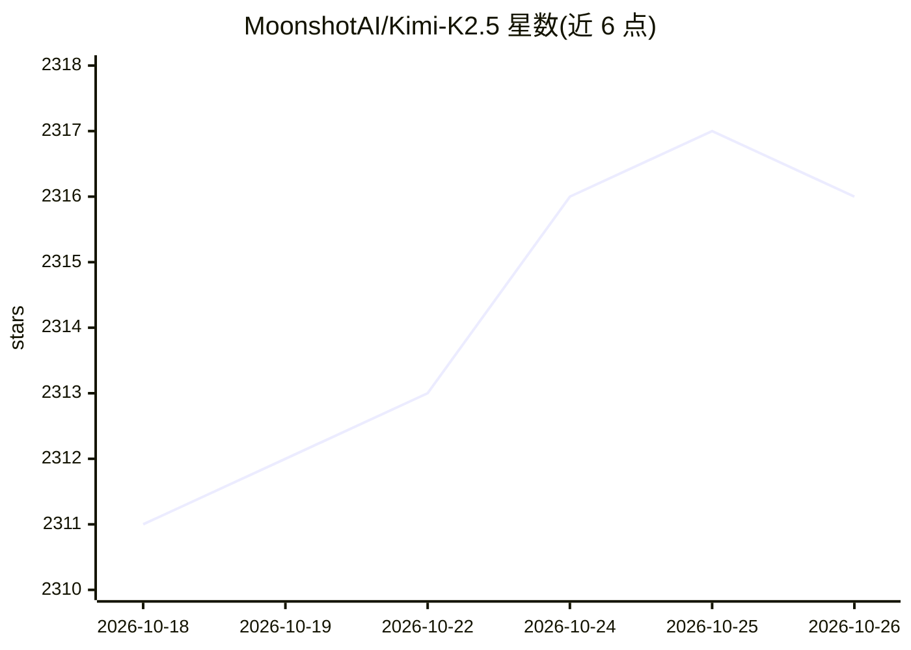

# MoonshotAI/Kimi-K2.5

⭐ 2,316 · NOASSERTION · 推送 2026-08-06 · [GitHub](https://github.com/MoonshotAI/Kimi-K2.5) · 组织维护 · 中文 README

**开源多模态 agentic 基础模型：视觉-语言理解与工具编排**

MoonshotAI 发布的开源原生多模态 agentic 模型，在 Kimi-K2-Base 上以约 15 万亿混合视觉与文本 token 持续预训练。MoE 架构，总参数 1T、激活 32B，上下文 256K，视觉编码器 MoonViT（400M），采用原生 INT4 量化。支持即时/思考双模式、交错思考与多步工具调用、Agent Swarm 多智能体并行执行，可从 UI 设计图生成代码。提供官方 API（OpenAI/Anthropic 兼容），可经 vLLM、SGLang、KTransformers 部署，代码与权重采用 Modified MIT 许可。

## 筛选速览

| 维度 | 判定 | 备注 |
|---|---|---|
| AI 角色 | `ai-native` | 本体是模型或模型工具 |
| 许可风险 | `none` | NOASSERTION |
| 部署形态 | `None` |  |
| 模型依赖 | local-ok | 支持本地模型 |
| 硬件要求 | — | 无带数字的原话,不猜 |
| 安装摩擦 | `low` | 无编译、无系统依赖或容器化 |
| 成熟度 | — | 结构信号不足 |

## 能力要点

- MoE 架构：总参数 1T，每 token 激活 32B，上下文 256K
- 原生多模态预训练，MoonViT 视觉编码器（400M 参数）
- Agent Swarm：任务分解为动态子代理并行执行
- 支持即时/思考双模式与交错思考、多步工具调用

## 适用场景

- 通过官方或自部署 API 进行图像/视频理解与问答
- 作为 coding agent（配合 Kimi Code CLI）执行编程任务
- 在 agentic search 场景中配合搜索与浏览器工具完成复杂检索

## 场景标签

`多模态` `编码 Agent` · 领域:编码与开发

## 证据(README 行号)

> L18: Kimi K2.5 is an open-source, native multimodal agentic model built through continual pretraining on approximately 1
> L21: - **Native Multimodality**: Pre-trained on vision–language tokens, K2.5 excels in visual knowledge, cross-modal rea
> L23: - **Agent Swarm**: K2.5 transitions from single-agent scaling to a self-directed, coordinated swarm-like execution 

## 星数曲线

2026-10-18 2,311 → 2026-10-26 2,316（+5）

---
*卡片 v1 · prompt 1.4 · 生成 2026-10-21 · 置信度 high · 依据 README sha `1a94d06ef1ee` · [字段定义](../../DATASET.md)*
