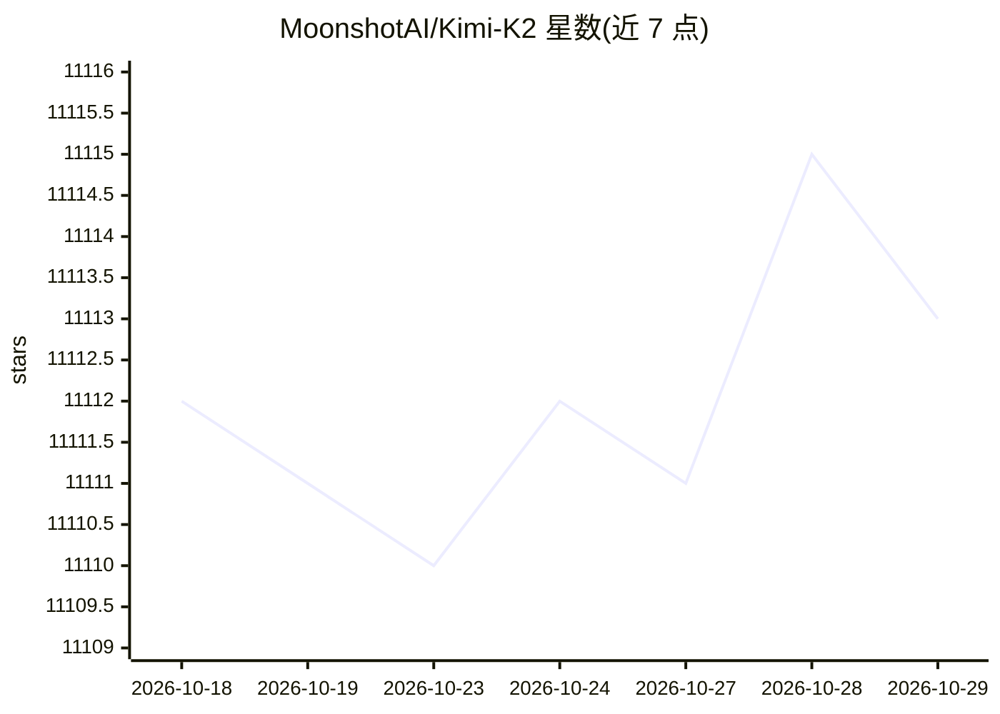

# MoonshotAI/Kimi-K2

⭐ 11,113 · NOASSERTION · 推送 2026-01-21 · [GitHub](https://github.com/MoonshotAI/Kimi-K2) · 组织维护 · 中文 README

**Moonshot AI 的开源 1T 参数 MoE 大语言模型（激活 32B）**

Kimi K2 是月之暗面团队发布的混合专家（MoE）大语言模型系列，总参数 1T、激活参数 32B、上下文 128K，使用 MuonClip 优化器在 15.5T tokens 上预训练，面向工具调用、推理与自主问题求解等 agentic 能力设计。提供 Base 与 Instruct 两个变体，权重以 block-fp8 格式发布在 Hugging Face，代码与权重均采用 Modified MIT 许可。可通过 Moonshot 平台的 OpenAI/Anthropic 兼容 API 访问，或经 vLLM、SGLang、KTransformers、TensorRT-LLM 等推理引擎本地部署，README 附 chat 与 tool calling 调用示例。

## 筛选速览

| 维度 | 判定 | 备注 |
|---|---|---|
| AI 角色 | `ai-native` | 本体是模型或模型工具 |
| 许可风险 | `none` | NOASSERTION |
| 部署形态 | `None` |  |
| 模型依赖 | local-ok | 支持本地模型 |
| 硬件要求 | — | 无带数字的原话,不猜 |
| 安装摩擦 | `low` | 无编译、无系统依赖或容器化 |
| 成熟度 | — | 结构信号不足 |

## 能力要点

- 1T 总参数 MoE 架构，激活 32B，上下文长度 128K
- 提供 Base（可微调）与 Instruct（通用对话/agent）两个变体
- 支持 OpenAI 兼容 chat 接口与原生工具调用管线
- 权重 block-fp8 格式发布，支持 vLLM/SGLang/KTransformers/TensorRT-LLM 部署

## 适用场景

- 搭建本地大模型推理服务并接入工具调用
- 作为基座模型做微调或定制训练
- 通过 API 使用 agentic 编码与推理能力

## 场景标签

 · 领域:大模型/自然语言处理

## 证据(README 行号)

> L18: Kimi K2 is a state-of-the-art mixture-of-experts (MoE) language model with 32 billion activated parameters and 1 tr
> L26: - **Kimi-K2-Base**: The foundation model, a strong start for researchers and builders who want full control for fin
> L27: - **Kimi-K2-Instruct**: The post-trained model, best for drop-in, general-purpose chat and agentic experiences. It 

## 星数曲线

2026-10-18 11,112 → 2026-10-29 11,113（+1）

---
*卡片 v1 · prompt 1.4 · 生成 2026-10-20 · 置信度 high · 依据 README sha `5570ba5a0b29` · [字段定义](../../DATASET.md)*
