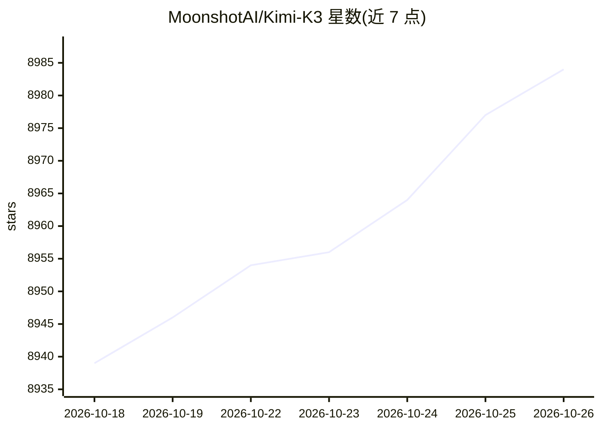

# MoonshotAI/Kimi-K3

⭐ 8,984 · NOASSERTION · 推送 2026-08-06 · [GitHub](https://github.com/MoonshotAI/Kimi-K3) · 组织维护 · 中文 README

**开源权重的原生多模态 agentic 前沿模型（2.8T MoE）**

MoonshotAI 发布的开源权重模型：2.8T 参数 MoE 架构（激活 104B），基于 Kimi Delta Attention 与 Attention Residuals，激活 896 专家中的 16 个；原生支持文本与图像视觉输入，上下文窗口 100 万 token；从 SFT 阶段起采用量化感知训练（MXFP4 权重 / MXFP8 激活）。面向长时程编程、知识工作与推理等 agentic 场景。权重以 Kimi K3 License 发布，官方提供 platform.kimi.ai API（OpenAI/Anthropic 兼容），推荐运行于 vLLM、SGLang、TokenSpeed 推理引擎；思考始终开启并返回 reasoning_content。

## 筛选速览

| 维度 | 判定 | 备注 |
|---|---|---|
| AI 角色 | `ai-native` | 本体是模型或模型工具 |
| 许可风险 | `none` | NOASSERTION |
| 部署形态 | `None` |  |
| 模型依赖 | local-ok | 支持本地模型 |
| 硬件要求 | — | 无带数字的原话,不猜 |
| 安装摩擦 | `low` | 无编译、无系统依赖或容器化 |
| 成熟度 | — | 结构信号不足 |

## 能力要点

- 2.8T MoE 架构（激活 104B / 896 专家选 16），1M token 上下文
- 原生多模态（文本/图像，MoonViT-V2 视觉编码器）
- MXFP4 量化感知训练（SFT 阶段起）
- 提供 OpenAI/Anthropic 兼容 API，推荐 vLLM/SGLang/TokenSpeed 部署

## 适用场景

- 通过 API 或开源权重进行长时程编程与仓库级工程任务
- 深度研究、知识工作与 agentic 工具调用
- 本地/自有基础设施部署前沿开源权重模型做推理与微调研究

## 场景标签

`多模态` `编码 Agent` · 领域:编码与开发

## 证据(README 行号)

> L19: Kimi K3 is an open-weight, native multimodal agentic model and our most capable model to date. It is a 2.8T-paramet
> L26: - **Open Frontier Weights**: We release the full Kimi K3 model weights under the Kimi K3 License, making frontier i
> L514: Kimi K3 always has thinking enabled, and will return `reasoning_content`. Thinking effort is configured with the t

## 星数曲线

2026-10-18 8,939 → 2026-10-26 8,984（+45）

---
*卡片 v1 · prompt 1.4 · 生成 2026-10-20 · 置信度 high · 依据 README sha `042323c851a5` · [字段定义](../../DATASET.md)*
