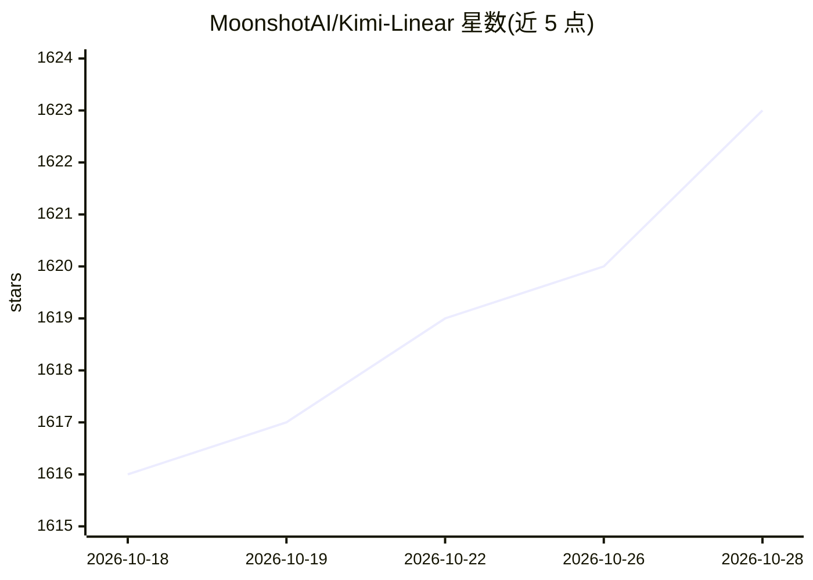

# MoonshotAI/Kimi-Linear

⭐ 1,624 · MIT · 推送 2025-11-17 · [GitHub](https://github.com/MoonshotAI/Kimi-Linear) · 组织维护 · 中文 README

**月之暗面开源的混合线性注意力架构模型（48B/A3B）**

MoonshotAI 开源的 Kimi Linear：一种混合线性注意力架构，核心为 Kimi Delta Attention（KDA），对 Gated DeltaNet 的门控机制做细化，按 3:1 比例混合 KDA 与全局 MLA。发布 48B 总参/3B 激活参数的 Base 与 Instruct 两个 checkpoint，上下文长度 1M，训练使用 5.7T tokens；README 报告其减少 KV cache 需求（最多 75%）并提升长序列解码吞吐（最多 6 倍）。可通过 Hugging Face Transformers 加载推理，或用 vLLM 部署为 OpenAI 兼容 API。

## 筛选速览

| 维度 | 判定 | 备注 |
|---|---|---|
| AI 角色 | `ai-native` | 本体是模型或模型工具 |
| 许可风险 | `permissive` | MIT |
| 部署形态 | `library` | 以包/库形式分发 |
| 模型依赖 | local-ok | 支持本地模型 |
| 硬件要求 | — | 无带数字的原话,不猜 |
| 安装摩擦 | `low` | 无编译、无系统依赖或容器化 |
| 成熟度 | — | 结构信号不足 |

## 能力要点

- KDA：细化门控的线性注意力机制，配套开源 FLA kernel（fla-core 包）
- 3:1 KDA 与全局 MLA 混合架构，1M 上下文长度
- 提供 48B/A3B 的 Base 与 Instruct 两个 checkpoint（5.7T tokens 训练）
- 支持 Transformers 加载与 vLLM 部署（OpenAI 兼容 API）

## 适用场景

- 用 Transformers 或 vLLM 部署长上下文（至 1M tokens）的语言模型
- 研究混合线性注意力架构与长序列推理效率
- 作为需要高吞吐解码的本地推理后端模型

## 场景标签

 · 领域:大模型/模型架构

## 证据(README 行号)

> L18: Kimi Linear is a hybrid linear attention architecture that outperforms traditional full attention methods across va
> L27: |Kimi-Linear-Base|48B|3B|1M|🤗 Hugging Face|

## 星数曲线

2026-10-18 1,616 → 2026-10-28 1,623（+7）

---
*卡片 v1 · prompt 1.4 · 生成 2026-10-21 · 置信度 high · 依据 README sha `dd2d1e32ebe9` · [字段定义](../../DATASET.md)*
