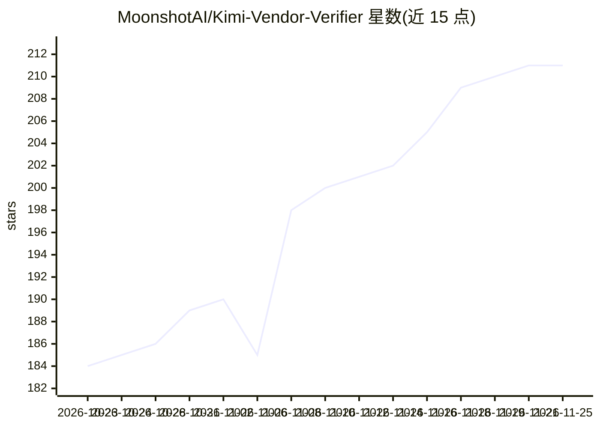

# MoonshotAI/Kimi-Vendor-Verifier

⭐ 211 · Python · MIT · 推送 2026-11-23 · [GitHub](https://github.com/MoonshotAI/Kimi-Vendor-Verifier) · 组织维护 · 中文 README

**给 Kimi 模型供应商部署做准确率与 API 功能验收的评测工具**

Moonshot 提供的供应商部署验证器：用 inspect-ai 运行 OCRBench、MMMU Pro Vision、BEAM(1M)、DeepSWE 等基准，另含独立 pytest 套件验证 API 参数约束、tool-call JSON schema、畸形请求拒绝、K3 特性契约与 prompt_tokens 计数准确性。以 uv 管理 Python 依赖，通过 KIMI_API_KEY/KIMI_BASE_URL 环境变量指向待测端点，支持 kimi 官方 API 与开源部署（vLLM/SGLang/KTransformers）两种 think-mode。

## 筛选速览

| 维度 | 判定 | 备注 |
|---|---|---|
| AI 角色 | `ai-ecosystem` | LLM/agent 周边工具 |
| 许可风险 | `permissive` | MIT |
| 部署形态 | `library` | 以包/库形式分发 |
| 模型依赖 | local-ok | 支持本地模型 |
| 硬件要求 | — | 无带数字的原话,不猜 |
| 安装摩擦 | `low` | 无编译、无系统依赖或容器化 |
| 成熟度 | — | 结构信号不足 |

## 能力要点

- 基于 inspect-ai 的基准评测与独立 pytest 验证器两类评测
- tool-call schema 校验含流式重组与 walle Go 补充用例
- --think-mode opensource 适配 vLLM 等开源部署的 reasoning_effort 参数
- 提供 GitLab CI 集成与 JUnit XML/JSON 报告

## 适用场景

- 接入 Kimi 模型的供应商上线前做 API 合规验收
- 对自建 vLLM/SGLang 部署跑基准对齐官方结果
- 回归验证供应商端点的 tool-call 与 token 计数行为

## 场景标签

`模型评测` · 领域:评测与运维

## 证据(README 行号)

> L5: Kimi Vendor Verifier (KVV) verifies whether a vendor deployment meets Kimi model accuracy and API feature requiremen
> L62: |Agent benchmark|DeepSWE|Multi-step tool-use and coding-agent evaluation, run on the Pier platform|

## 星数曲线

2026-10-23 184 → 2026-11-25 211（+27）

---
*卡片 v1 · prompt 1.4 · 生成 2026-11-25 · 置信度 high · 依据 README sha `ee6277b09c00` · [字段定义](../../DATASET.md)*
