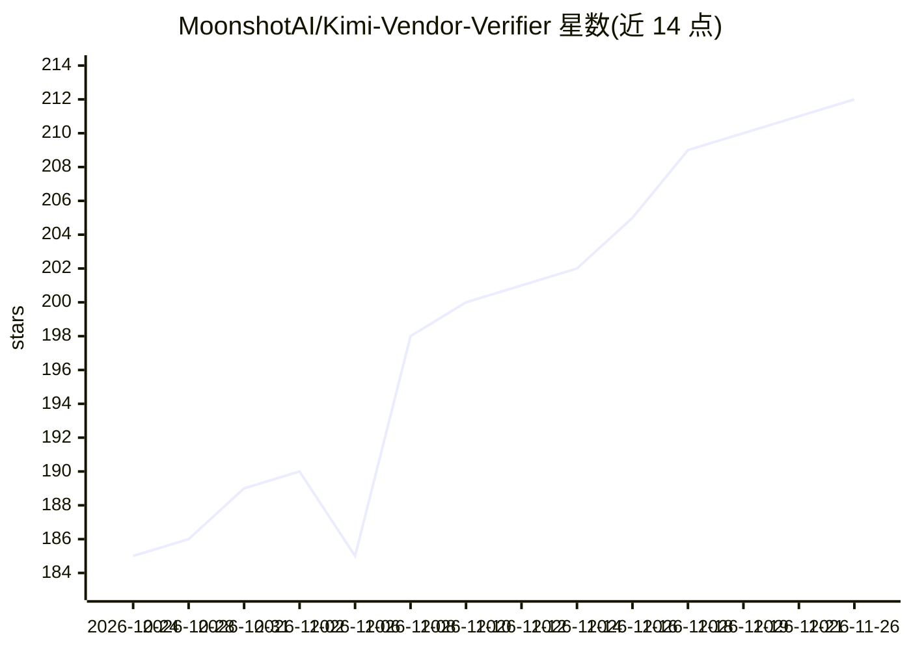

# MoonshotAI/Kimi-Vendor-Verifier

⭐ 212 · Python · MIT · 推送 2026-11-24 · [GitHub](https://github.com/MoonshotAI/Kimi-Vendor-Verifier) · 组织维护 · 中文 README

**验证厂商 Kimi 模型部署的准确性与 API 功能符合度**

KVV 是一个针对 Kimi 模型厂商部署的验证工具：包含基于 inspect-ai 的基准评测（OCRBench、MMMU Pro Vision、BEAM 1M 长上下文、DeepSWE 多步工具使用）和直接调用 chat-completions API 的独立校验器（API 参数约束、工具调用 JSON Schema、非法请求拒绝、K3 特性、prompt_tokens 计数核对）。README 提供多家厂商的评测结果表。要求提供 KIMI_API_KEY 与 KIMI_BASE_URL，使用 uv 管理依赖并以 pytest 运行各项检查。

## 筛选速览

| 维度 | 判定 | 备注 |
|---|---|---|
| AI 角色 | `ai-ecosystem` | LLM/agent 周边工具 |
| 许可风险 | `permissive` | MIT |
| 部署形态 | `library` | 以包/库形式分发 |
| 模型依赖 | local-ok | 支持本地模型 |
| 硬件要求 | — | 无带数字的原话,不猜 |
| 安装摩擦 | `low` | 无编译、无系统依赖或容器化 |
| 成熟度 | — | 结构信号不足 |

## 能力要点

- 基于 inspect-ai 的多模态与长上下文基准评测
- Pytest 校验器验证 API 参数约束、工具调用 Schema 与 HTTP 400 行为
- 核对厂商上报的 usage.prompt_tokens 是否准确
- 支持 kimi 官方 API 与 vLLM/SGLang 等开源部署两种 think-mode

## 适用场景

- 上线前验证厂商部署的 Kimi 模型是否达到精度与 API 功能要求
- 对开源推理服务做 API 参数与工具调用合规性预检
- 复现并对照各厂商的基准评测结果

## 场景标签

`模型评测` · 领域:评测与运维

## 证据(README 行号)

> L5: Kimi Vendor Verifier (KVV) verifies whether a vendor deployment meets Kimi model accuracy and API feature requiremen
> L97: # Open-source deployment (vLLM/SGLang/KTransformers)
> L166: |`--think-mode`|`kimi` (official API) or `opensource` (vLLM etc.)|`THINK_MODE` env var, otherwise `kimi`|

## 星数曲线

2026-10-24 185 → 2026-11-26 212（+27）

---
*卡片 v1 · prompt 1.4 · 生成 2026-11-26 · 置信度 high · 依据 README sha `611137d04d3a` · [字段定义](../../DATASET.md)*
